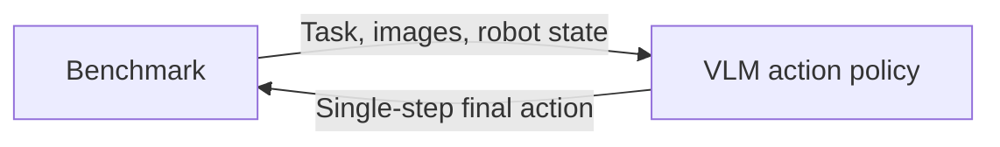
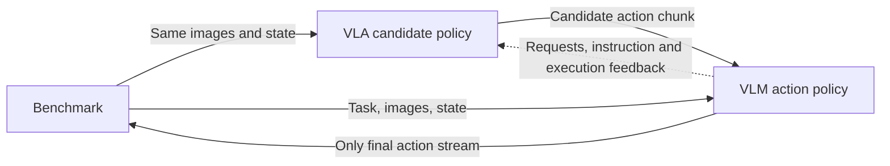

English | [简体中文](DESIGN_zh.md)

# VLM action-policy design

Use the same `operator-vlm-action-policy` Node for **standalone VLM control** and **VLA + VLM control**, packaged as benchmark Skill profiles.

The Node owns its model API client or in-process local model. It does not depend on the existing operator-vlm-policy service. **This is a design proposal, not an implementation.**

## Scenario A: standalone VLM

The VLM generates an action chunk from the task, images and robot state, then sends actions to the environment one step at a time.

| Node | Inputs | Outputs | Responsibility |
|---|---|---|---|
| Benchmark | Single-step action | Task, images, state, evaluation results | Run simulation, advance environment, score success |
| VLM action policy | Task, images, state | Generated chunk and single-step final actions | Model inference, action checks and queue management |

**Loop:** observe → generate a chunk → execute its prefix, waiting for a new observation after every step → replan. Discard the unused tail when replanning.

| Important setting | Meaning | Example |
|---|---|---|
| mode | Standalone control | standalone |
| model.backend | Backend owned directly by this Node | Provider API or in-process local model |
| action.space / dimension | Action type and row width | EEF delta / 7 |
| action.prediction_horizon | Steps generated per inference | 4 |
| action.execute_horizon | Maximum steps before replanning | 2 |

Full drafts: [policy](../examples/libero/policy.yaml) · [dataflow](../examples/libero/dataflow.yaml) · [benchmark](../examples/libero/benchmark.yaml).

## Scenario B: VLA proposes, VLM decides

VLA supplies candidate actions. The VLM keeps or refines them using the same task and observations. Reuse the VLM action Node from A.

| Node | Inputs | Outputs | Responsibility |
|---|---|---|---|
| Benchmark | Single-step action from the VLM Node | Task, images, state, results | Run simulation and score success |
| VLA candidate policy | Task, images, state, candidate requests, execution feedback | Candidate chunks | Generate on request; no direct environment control |
| VLM action policy | VLA candidate, task, images, state | Final chunk, single-step actions, execution feedback | Keep/refine candidates and own final execution |

**Loop:** observe → request VLA candidates → VLM keeps/refines → validate → execute stepwise → report actual execution to VLA → replan.

Initially allow **retention or bounded refinement**, preserving VLA gripper commands by default. Evaluate full replanning separately later.

| Important setting | Meaning | Example |
|---|---|---|
| mode | Use VLA candidates | vla_conditioned |
| candidate.expected_horizon | Candidate steps from VLA | 8 |
| action.prediction_horizon | Final steps formed by VLM | 4 |
| action.execute_horizon | Maximum executed prefix | 2 |
| candidate.dimension / action.dimension | Candidate/final row width | Initially both 7 with matching semantics |
| refinement.strategy | Candidate treatment | bounded_residual |
| refinement.allow_gripper_override | Allow gripper changes | false by default |

Candidate chunks, requests and feedback require VLA-runner extensions. VLA must not independently dequeue or write environment actions. Match observations and candidates using the same episode/step identity.

Full drafts: [final policy](../examples/vla_vlm/policy.yaml) · [VLA](../examples/vla_vlm/vla.yaml) · [dataflow](../examples/vla_vlm/dataflow.yaml) · [benchmark](../examples/vla_vlm/benchmark.yaml).

## Shared rules

- **Environment inputs are single-step.** Manage chunks inside the policy and consume them using fresh observations.
- **Horizons and dimensions are configurable with explicit semantics.** EEF delta typically has 7 values; position, quaternion and gripper has 8; N joints plus gripper usually has N+1. Changing width alone does not convert types.
- **Default LIBERO uses EEF controls.** Joint output needs genuine joint state and a matching controller; see the [joint draft](../examples/joint/policy.yaml).
- **Reset clears the whole policy chain.** Invalidate queues, context and late results. History includes only acknowledged execution.
- **Account for failures explicitly.** Timeout/invalid actions default to evaluation abort, without hidden fallback. Benchmark owns success scoring.

Freeze control period, units, frame, gripper convention, limits and timeouts in configuration. Model denormalization and controller scaling are separate operations. See [interface notes](CONTRACTS.md) for the detailed contract.

## Skill and evaluation

Provide vlm_only and vla_vlm profiles containing the relevant dataflow, model settings, prompts, action contract and benchmark plan. A has two business Nodes; B has three. Add one Gateway for Agent Tool control in either case.

The Agent starts batches and retrieves results; Nodes handle per-step execution. Gateway reuses benchmark describe/run operations and never selects actions.

Compare **VLA baseline, A and B** with fixed tasks/init states. Record success, environment steps, wall time and inference usage. B additionally records refinement and fallback rates.

Confirm and validate A first, then introduce the VLA candidate interface for B. Configuration values are examples, with no implementation or performance validation claimed.

References: [benchmark-libero](https://github.com/PhyAgentOS/benchmark-libero) · [operator-lerobot-runner](https://github.com/PhyAgentOS/operator-lerobot-runner).
