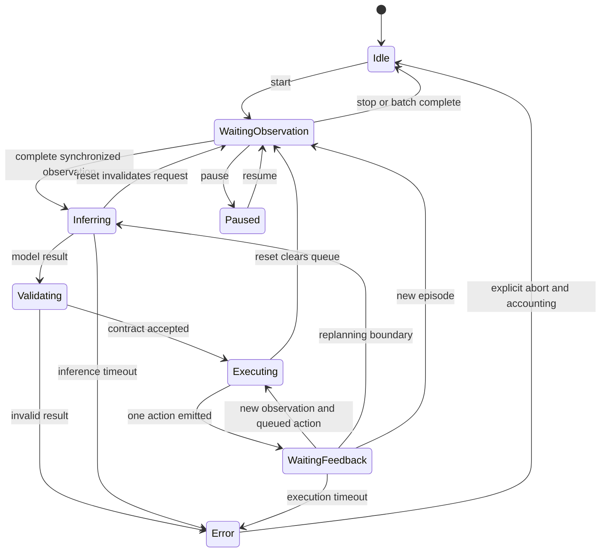

English | [简体中文](DESIGN_zh.md)

# Standalone VLM action policy and benchmark Skill proposal

## 1. Scope

This deliverable is a design proposal only. `operator-vlm-action-policy` is planned
as an independent, persistent internal policy Node with the role of a VLA policy:
instruction + images + robot state → action chunk.

**The Node owns model integration, input assembly, inference and action decoding.
It does not call the existing operator-vlm-policy HTTP service.** It may call the
configured model provider API directly, or load a local model inside its process.
The backend is configured and managed by this Node. API mode does not require a
separate PAOS general-purpose VLM service.

All interfaces and configurations below are proposed. No implementation,
benchmark success rate, runnable artifact or Skill acceptance is claimed.

## 2. Overall flow

```mermaid
flowchart LR
    agent["PAOS Agent"] -->|"optional batch request"| gateway["Gateway"]
    gateway -->|"describe / run Session"| benchmark["benchmark-libero"]
    benchmark -->|"instruction, obs_state, obs_image"| policy["operator-vlm-action-policy"]
    policy -->|"one native action"| benchmark
    benchmark -->|"new observation, episode events, final result"| policy
    benchmark -->|"official score and report"| gateway
    subgraph policyInternal["Responsibilities inside the policy Node"]
        sync["Observation and episode synchronization"] --> model["Own model backend and inference"]
        model --> decode["Action decoding and semantic validation"]
        decode --> queue["Chunk scheduling and control adaptation"]
    end
    policy -.-> sync
    queue -.-> policy
```



The minimum loop has two business Nodes: benchmark and action policy. Add Gateway
for Agent Tool control, giving three Dora Nodes. A model provider API is an
external model backend; a local backend may run within the policy process. No
operator-vlm-policy service or bridge is included.

Synchronization, inference, decoding, queueing and control adaptation are internal
modules rather than separate dataflow Nodes. Recognition, action generation and
review may use prompts/context in the same policy; an independent grounding Node
is not required in the MVP.

## 3. Node inputs and outputs

| Node | Inputs | Outputs | Ownership |
|---|---|---|---|
| benchmark-libero | `action`; optional `tool_in` | `proprio_state`, `image/main`, `image/second`, `policy_command`, `benchmark_status`, `benchmark_result`; optional `tool_out` | Exclusive environment reset/step, task/init-state plan, official success, video/report |
| proposed action policy | `tick`, `policy_command`, `proprio_state`, configured `image/*`, `benchmark_result` | `action`, `action_chunk`, `policy_state`, `policy_error` | Own model backend, synchronized inputs, context, generation, validation and action scheduling |
| optional existing Gateway | Agent Tool requests, benchmark Tool responses | Benchmark Tool requests, Agent responses | Query/Session lifecycle; no per-step action decision |

The benchmark advances the environment; the policy supplies the only action
stream; the Agent manages the evaluation task. The policy does not create or step
a second environment instance.

## 4. Observation contract

Logical input contains instruction, multi-camera images, typed robot state,
`episode_id/epoch/step_id/obs_id/sim_time`, and acknowledged execution feedback.
`set_instruction` updates the task. Images and state must refer to the same
environment observation, with explicitly declared dimensions, units and frames.

Current LIBERO eight-dimensional state is EEF position(3), axis-angle(3) and two
finger positions. Historical `joint1..joint7, gripper` carrier labels do not imply
seven measured arm joint angles. Joint mode needs genuine joint observations.

Integration is planned in two stages:

- Prototype: retain upstream ports under a single producer/writer lockstep
  assumption, collect a fresh sample from every required stream, and handle
  cross-port reordering/reset races. Merely caching latest values proves no
  atomic synchronization.
- Production: extend benchmark with common episode/step identity on every image
  and state, or a complete observation envelope. Both policy and benchmark reject
  actions with stale identities. The current upstream does not provide the full
  correlation contract; this is a planned benchmark extension.

Do not expose privileged object poses, full simulator state or evaluator
predicates to the policy. Depth, calibration and auxiliary vision Tools require
separately disclosed observation profiles.

## 5. Action contract

`action_chunk` is a proposed application contract, not an assertion that an
identical Forge message already exists:

```text
schema_version, chunk_id
episode_id, epoch, source_obs_id, source_step_id
action_space, frame, units, joint_names (joint mode)
dt_s, actions[H,D], execute_horizon
```

| Space | Per-row content | Convention | Execution |
|---|---|---|---|
| `eef_delta` | Translation 3 + rotation increment 3 + gripper 1 | Metres, rotation-vector radians, explicit frame/gripper convention | Adapt to environment EEF controls |
| `eef_pose` | Position 3 + quaternion 4 + gripper 1 | Metres, unit xyzw quaternion | Recompute pose error from fresh feedback |
| `joint_position` | N joint positions + gripper | Named order; radians for revolute, metres for prismatic joints | Matching joint-position controller |

Prioritize EEF delta for default LIBERO while defining EEF pose and joint
contracts. Default LIBERO seven-dimensional actions are EEF controls plus
gripper, not seven joint angles. A JointCommand carrier does not change this
semantics. Confirm controller type, delta/absolute convention, scaling, frame,
rotation composition and gripper direction explicitly.

EEF→IK→joint is unnecessary for default LIBERO OSC. A joint controller/robot
route may use an explicit IK adapter with its own kinematic model, TCP, solver
failure, residual, joint-limit and continuity checks. Changing controller/action
space changes the evaluation protocol and requires separate reporting.

Validate dimensions, finite numbers, units, frames, step limits, joint bounds,
workspace and applicable reachability before emission. Collision guarantees need
an independently validated collision/planning component; range checks are
insufficient to establish safety.

## 6. Persistent state and execution flow



1. Benchmark resets and establishes episode identity/instruction.
2. Policy clears prior queues, requests and context, then collects fresh inputs.
3. Its own model backend receives images, state, task, bounded history and action
   contract.
4. Generate H rows; validate and execute the configured first M, discarding the tail.
5. One complete fresh observation grants one action credit. After emission wait
   for feedback; a timer never grants extra environment steps.
6. Continue queued actions, feedback-servo an absolute pose, or replan.
7. Benchmark scores with official predicates. Policy clears episode state and
   remains resident for the next episode/batch.

Ticks schedule inference/result checks; a 20ms timer does not promise 20ms model
latency or wall-clock real-time simulation. Lockstep pauses simulation while
waiting for inference. Report wall-clock and simulation time separately.

Reset/task/instruction changes, pause and stop invalidate the generation. A
backend that cannot physically cancel must still have its late result discarded.
Async prefetch is a later optimization after a correct synchronous baseline.
Context is episode-scoped; include only acknowledged executed actions, not an
unexecuted chunk tail. Define explicit image/history retention and avoid hidden
cross-episode conversations.

## 7. Errors and stopping

Record malformed output, action mismatch, inference timeout, IK/reachability
failure and execution timeout separately. Do not silently substitute arbitrary
movement or zero commands. Model completion is a prediction; official success
comes from the benchmark.

Upstream benchmark Session stop currently lands at an episode boundary. It lacks
a full policy-failure/immediate-abort contract. Production integration needs a
structured policy_error→benchmark abort or orchestration interruption route that
finishes and persists a waiting episode as failed rather than hanging. The sample
does not invent an existing upstream abort input.

## 8. Proposed dataflow.yaml

Existing benchmark ports follow the reference repository. The new policy and its
entrypoint are future artifacts; `/opt/nodes/...` paths are placeholders. Select
one compatible Dora/Forge line before implementation. Current benchmark main uses
Dora 0.4.1; Forge 2 migration is a separate line requiring validation.

```yaml
# DESIGN ONLY: operator-vlm-action-policy is a future artifact, not implemented here.
# Existing LIBERO port names follow the referenced benchmark-libero repository.
# Select one compatible Dora/Forge version for ALL artifacts before implementation.
nodes:
  - id: libero_benchmark
    path: /opt/nodes/libero_benchmark
    env:
      BENCHMARK_CONFIG: ./benchmark.yaml
      MUJOCO_GL: egl
      PYOPENGL_PLATFORM: egl
    inputs:
      action:
        source: vlm_policy/action
        queue_size: 1
    outputs:
      - proprio_state
      - image/main
      - image/second
      - policy_command
      - benchmark_status
      - benchmark_result

  - id: vlm_policy
    path: /opt/nodes/operator-vlm-action-policy
    args: --config ./policy.yaml
    inputs:
      tick: dora/timer/millis/20
      policy_command:
        source: libero_benchmark/policy_command
        queue_size: 32
      proprio_state:
        source: libero_benchmark/proprio_state
        queue_size: 1
      image/main:
        source: libero_benchmark/image/main
        queue_size: 1
      image/second:
        source: libero_benchmark/image/second
        queue_size: 1
      benchmark_result: libero_benchmark/benchmark_result
    outputs:
      - action
      - action_chunk
      - policy_state
      - policy_error
```

Related drafts: [policy](../examples/libero/policy.yaml),
[benchmark](../examples/libero/benchmark.yaml), [joint](../examples/joint/policy.yaml).
Model configuration belongs to this action Node; there is no service_url or
general VLM bridge.

## 9. Skill and Tools

The Skill will package pinned Node references, dataflow, model configuration,
prompts, action schema, control profile and evaluation plan. It does not implement
a per-step natural-language Agent loop.

```text
vlm-libero-benchmark/
  SKILL.md
  skill.yaml
  profiles/libero/
    dataflow.yaml
    gateway.yaml (Tool-controlled batches)
    benchmark.yaml
    policy.yaml
    control_profile.yaml
  schemas/
    observation.json
    action_chunk.json
```

With Gateway, use the existing benchmark.controller Endpoint:

| Suggested Tool | Operation | Semantics | Provider |
|---|---|---|---|
| `vlm_libero.benchmark.describe` | `describe` | Query | benchmark-libero |
| `vlm_libero.benchmark.run` | `run` | Session | benchmark-libero |

No policy ToolEndpoint is planned initially. Runtime commands such as
start/set_instruction/reset_scene/stop use lifecycle streams. Evaluate a model
resource-management Endpoint only if an independent management need arises.

Agent sequence: deployment/model readiness→describe live tasks/limits→start a
Session for the agreed plan→poll status→read terminal result/report. Acceptance
is not completion; a completed batch does not imply 100% task success. Keep
credentials in the deployment environment and exclude keys, weights and datasets
from the Skill package.

## 10. Evaluation and pre-implementation decisions

- Freeze tasks, init states, seeds, model/effort, prompts, image handling,
  controller and generated/executed horizons.
- Record official task/overall success, scheduled/completed episodes, termination
  reasons, environment steps, simulation/wall time, model calls/latency and token
  usage. Cost needs pricing evidence.
- Preserve invalid actions, timeouts, interruptions and infrastructure failures;
  do not report only completed episodes.
- Validate contracts/reset first, actual Dora+LIBERO second, and model capability
  third. Passing code tests cannot replace real evaluation.
- Confirm first backend (direct API or in-process local), Dora/Forge version,
  strict observation identity, failure/abort protocol and the joint-mode
  downstream environment/controller before implementation.

## 11. References

- [benchmark-libero](https://github.com/PhyAgentOS/benchmark-libero): `_core/runner.py`,
  `adapters/libero_adapter.py`, `dataflow.example.yaml`, `bench_tool/descriptor.py`.
- [LIBERO environment wrapper](https://github.com/Lifelong-Robot-Learning/LIBERO/blob/master/libero/libero/envs/env_wrapper.py).
- [robosuite controllers](https://robosuite.ai/docs/modules/controllers).
