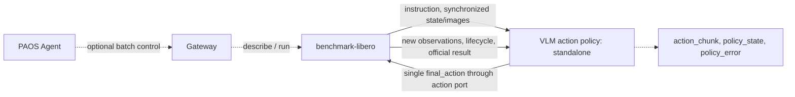
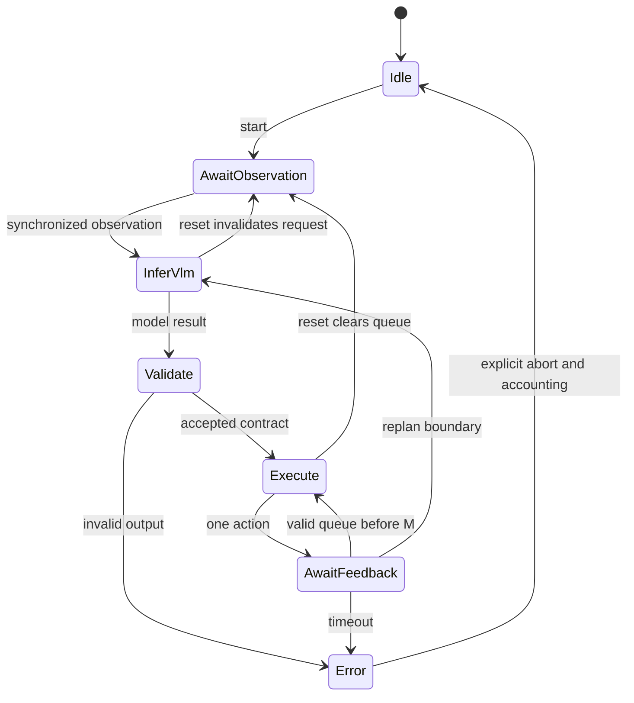
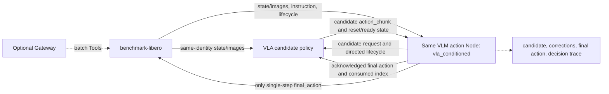
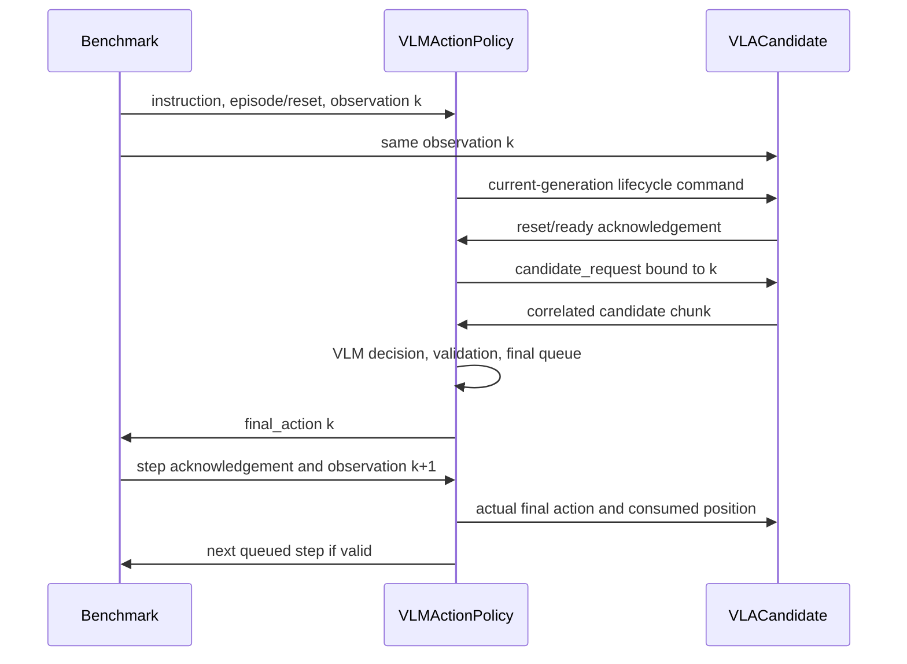

English | [简体中文](DESIGN_zh.md)

# VLM / VLA + VLM action-policy and benchmark Skill design

## 1. Scope and shared constraints

| Scenario | Policy inputs | Final decision | Business Nodes, excluding Gateway |
|---|---|---|---|
| A: standalone VLM | instruction, obs_state, obs_image | VLM generates the action chunk | 2: benchmark + VLM action policy |
| B: VLA + VLM | VLA candidate chunk, instruction, obs_state, obs_image | VLM keeps, refines or replans candidates | 3: benchmark + VLA candidate + the same VLM action policy |

Both scenarios use the proposed persistent **operator-vlm-action-policy** Node.
It owns its model backend, directly calling a provider API or loading a model
in-process. **It does not depend on operator-vlm-policy or a generic VLM bridge.**
`mode` selects input organization and decision behavior within this dedicated Node.

This is a design-only deliverable. New Nodes, ports, parameters and artifact paths
are proposals, not implementation claims. Existing interfaces and required
extensions are distinguished below. No Node is implemented or run for this change.

Benchmark exclusively owns environment reset/step and official scoring. Only the
VLM action policy writes native actions. Models generate chunks; the environment
consumes single steps. Correlate all observations/actions by episode and control
step, and freeze model/prompt/control parameters during evaluation.

## 2. Shared observation and action contracts

### 2.1 Observations

Logical inputs are instruction, typed obs_state, obs_image, observation_identity
and execution_feedback. Dora mapping uses policy_command, proprio_state and
image/* with explicit correlation/feedback information.

| Group | Required meaning |
|---|---|
| Identity | run_id, env_id, episode_id, epoch, obs_id, step_id |
| Time | sim_time and capture time; model return time is not a control-step timestamp |
| State | Values, semantic fields, units, frame and actual joint ordering when needed |
| Images | Camera ID, encoding, dimensions and source obs_id |
| Instruction | instruction and instruction_version |
| Acknowledgement | final_action_id, completed control step, execution result, next observation identity |

Current LIBERO eight-dimensional proprioception is EEF position(3), rotation
vector(3), and finger positions(2). Legacy joint1..joint7/gripper labels do not
represent seven measured arm joints. Joint mode requires genuine joint state.

A may prototype with existing ports under restricted legacy lockstep assumptions.
Caching latest values does not prove atomic synchronization. Production A and B
need common episode/step identity on all image/state streams or a complete
observation envelope. Upstream benchmark does not supply the full correlation
contract today; this is a required extension. B defaults to strict correlation.

### 2.2 Chunks and single-step final_action

```text
action_chunk:
  schema_version, chunk_id, policy_id
  episode_id, epoch, source_obs_id, source_step_id, instruction_version
  start_control_step, control_dt_s
  action_space, frame, dimension, layout, units
  joint_names, gripper_convention, normalization_profile
  actions[H,D]
```

This is a proposed application contract, not an existing same-named Forge message.
Both H and D are configurable and must match model decoding and controller semantics.

| Parameter | Meaning | Constraint |
|---|---|---|
| vla.prediction_horizon, H_vla | Candidate steps, scenario B | Matches candidate.expected_horizon |
| action.prediction_horizon, H_final | Final VLM chunk length | Initially fixed per profile and strictly validated |
| action.max_prediction_horizon | Configuration resource cap | Bounds H_final; not permission for arbitrary output lengths |
| action.execute_horizon, M | Maximum native control steps before replanning | For fixed-step actions: 1 ≤ M ≤ H_final; discard the tail |
| action.dimension, D_model | Model row width | Matches space/layout/units/joints/gripper |
| control_adapter.native_dimension, D_native | Environment row width | May differ after an explicit control adapter |
| action.control_dt_s | Discrete control period | Shared across policies or explicitly resampled |

Example: H_vla=8, H_final=4, M=2 and D_model=D_native=7. Review eight candidate
steps, form four final steps, execute two, then observe and replan. Input horizon,
output horizon and execution horizon are separate parameters. A pretrained VLA checkpoint constrains native H/D; validate compatibility and define any truncation/resampling explicitly. Configuration alone does not reshape its action head.

| Space | Model row | Semantics | Default LIBERO route |
|---|---|---|---|
| eef_delta | Translation 3 + rotation vector 3 + gripper, D=7 | Metres, radians, explicit frame | Explicitly normalize to seven-dimensional OSC |
| eef_pose | Position 3 + xyzw quaternion 4 + gripper, D=8 | Metres, unit quaternion | Compute seven-dimensional OSC delta using fresh EEF state |
| joint_position | N joints + gripper, usually D=N+1 | Named joints; rad/m per joint | Matching joint controller, not default OSC |

Default LIBERO 7D actions are EEF controls plus gripper. A JointCommand carrier
does not turn them into joint angles. Changing D alone cannot convert joint/EEF,
frames or gripper protocols. Default OSC needs no extra IK. An EEF→joint route
requires explicit kinematics/control adaptation with model/TCP, solver residual,
limits, continuity and failure semantics.

An absolute EEF pose need not be reached in one period. A multi-step servo must
account in native control steps and bound convergence. B initially prioritizes
fixed-period EEF delta or joint commands; nonuniform waypoints require explicit
time parameterization before candidate fusion.

Logical final_action is one control step, carried by the `action` dataflow port.
`action_chunk` records planning/tracing. Do not send an H×D matrix to LIBERO or
flood H individual messages instead of waiting for lockstep acknowledgements.

## 3. Scenario A: standalone VLM

### 3.1 Flowchart



Internally: synchronize→assemble task/executed history→own VLM backend→decode and
validate→final queue→single-step output. Two business Nodes, or three Dora Nodes
with optional Gateway. There is no separate generic VLM service.

### 3.2 Node inputs, outputs and responsibilities

| Node | Inputs | Outputs | Responsibility |
|---|---|---|---|
| benchmark-libero | action; optional tool_in | proprio_state, image/main, image/second, policy_command, benchmark_status, benchmark_result; optional tool_out | Environment, step/reset, task plan, official score, reports/video |
| proposed VLM action policy | tick, policy_command, proprio_state, configured image/*, benchmark_result | action, action_chunk, policy_state, policy_error | Own model integration, observation alignment, H_final×D generation, validation, M-step consumption, context/lifecycle |
| optional existing Gateway | Agent requests, benchmark Tool responses | Benchmark Tool requests, Agent responses | Batch invocation management; no per-step decision |

### 3.3 Execution and state

1. Benchmark resets, establishes identity and sends instruction/reset commands.
2. Policy invalidates prior requests/queues and waits for a complete observation.
3. Its model generates the configured shape; validate before enqueueing.
4. One new observation grants one action credit; emit one native action.
5. Wait for execution/next observation; record only acknowledged executed actions.
6. At M steps or invalidation/replanning, discard the tail and infer again.
7. Clear episode context at completion; remain resident for the next episode/batch.



### 3.4 Configuration and important parameters

Complete drafts: [policy](../examples/libero/policy.yaml),
[benchmark](../examples/libero/benchmark.yaml).

| Parameter | Example | Design meaning |
|---|---|---|
| policy.mode | standalone | No VLA input required |
| model.backend / model_name_env / effort_env | provider_api / VLM_MODEL / VLM_REASONING_EFFORT | Node directly owns model access; local backend is another option |
| observation.image_inputs / state_semantics | main, wrist; EEF 8D semantics | Explicit observation interpretation |
| synchronization / require_identity | legacy_lockstep / false | Prototype only; production needs correlated identity |
| action.space / dimension / layout / units / frame | eef_delta / 7 / named axes / SI / world | Bind width to semantics |
| prediction_horizon / max_prediction_horizon / execute_horizon | 4 / 8 / 2 | Generated length, resource cap and execution prefix |
| control_adapter.native_dimension / scales | 7 / 0.05m, 0.5rad | Examples only; verify actual OSC configuration |
| control_adapter.limits_source | robot_control_profile | Supply verified step/workspace/joint bounds and applicable servo tolerances/timeouts before implementation |
| runtime.tick_ms / inference_deadline_ms / feedback_timeout_ms | 20 / 60000 / 5000 | Scheduler/inference/execution budgets; no real-time guarantee |
| context.scope / max_executed_history | episode / 4 | Bounded acknowledged history, no unexecuted tail |
| runtime.on_error / async_prefetch | abort_evaluation / false | Synchronous baseline and explicit failure |
| benchmark.policy_id | vlm_libero | Matches final actor identity |
| suite / task_ids / init_state_ids / num_runs / seed | Frozen plan | Reproducible evaluation population |
| control_mode / camera_* / max_steps | relative / 256 / 300 | Control, observation and step budget |

### 3.5 Proposed dataflow.yaml

Existing benchmark ports are retained; new policy artifacts and /opt/nodes paths
are placeholders. Full [scenario A dataflow](../examples/libero/dataflow.yaml):

```yaml
# DESIGN ONLY: operator-vlm-action-policy is a future artifact, not implemented here.
# Existing LIBERO port names follow the referenced benchmark-libero repository.
# Select one compatible Dora/Forge version for ALL artifacts before implementation.
nodes:
  - id: libero_benchmark
    path: /opt/nodes/libero_benchmark
    env:
      BENCHMARK_CONFIG: ./benchmark.yaml
      MUJOCO_GL: egl
      PYOPENGL_PLATFORM: egl
    inputs:
      action:
        source: vlm_policy/action
        queue_size: 1
    outputs:
      - proprio_state
      - image/main
      - image/second
      - policy_command
      - benchmark_status
      - benchmark_result

  - id: vlm_policy
    path: /opt/nodes/operator-vlm-action-policy
    args: --config ./policy.yaml
    inputs:
      tick: dora/timer/millis/20
      policy_command:
        source: libero_benchmark/policy_command
        queue_size: 32
      proprio_state:
        source: libero_benchmark/proprio_state
        queue_size: 1
      image/main:
        source: libero_benchmark/image/main
        queue_size: 1
      image/second:
        source: libero_benchmark/image/second
        queue_size: 1
      benchmark_result: libero_benchmark/benchmark_result
    outputs:
      - action
      - action_chunk
      - policy_state
      - policy_error
```

## 4. Scenario B: VLA candidates with VLM final decisions

### 4.1 Flowchart



Three business Nodes, or four with Gateway. VLA produces candidates; VLM owns
final execution. VLA has no direct benchmark action route and does not dequeue
candidate rows as if they were executed.

### 4.2 Node inputs, outputs and responsibilities

| Node | Inputs | Outputs | Responsibility |
|---|---|---|---|
| benchmark-libero | Only vlm_policy/action; optional Tools | Same observations/tasks/results as A; planned correlation metadata | One environment and official scoring; no action fusion |
| VLA candidate, adaptation required | proprio_state, image/*, forwarded policy_command, proposed candidate_request/execution_feedback, tick | Proposed candidate action_chunk; policy_state/policy_error | Generate H_vla×D on request, denormalize own outputs, acknowledge reset/ready, maintain history using final executed actions |
| same VLM action policy | A inputs plus vla_action_chunk, vla_policy_state, vla_policy_error | A outputs plus candidate_command, candidate_request, execution_feedback, decision_trace | Align candidates/observations, keep/refine/replan, validate and own final queue/credits, feed actual execution back to VLA |
| optional existing Gateway | Same as A | Same as A | Batch control only |

Candidate chunk/request/execution feedback and reset acknowledgement are
**proposed VLA-runner extensions**. A runner that only emits single-step action
cannot be assumed to expose them. It must expose raw chunks before consumption
and disable native action emission/independent dequeue.

### 4.3 Correlation and lifecycle protocol

| Message | Important fields | Rule |
|---|---|---|
| candidate_command | target_policy_id (mapped to PolicyCommand.policy_id), episode_id, epoch, instruction_version, command | Final policy forwards directed lifecycle commands with the VLA identity; do not rely on mismatched broadcasts |
| policy_state acknowledgement | policy_id, episode_id, epoch, reset/ready state | Wait for current-generation readiness before requesting candidates |
| candidate_request | request_id, source_obs_id, epoch, start_control_step, requested_horizon, deadline | One live request per replan; bind a complete matching observation |
| VLA action_chunk | Shared chunk contract plus request_id | Validate provenance, control start, H/D, units and normalization |
| execution_feedback | final_action_id, candidate_chunk_id/index, applied_final_action, ack_step/ack_obs_id | Send after acknowledgement; VLA updates from final applied commands, not assumed execution of its own raw tail |

Match caches by obs_id. Do not pair a newer image with the first row of an old
candidate. Source observation, scheduled start and consumed position are distinct.
Reject or request again on mismatch rather than guessing a prefix to trim.

### 4.4 Decisions, timing and timeouts

Initial strategy: bounded_residual, allowing retention or bounded correction.
Trace keep/refine/replan, candidate identity, corrections, final output and
fallback/rejection reasons.

- Translation corrections use the same units/frame and vector-norm/final bounds.
- Rotation corrections need explicit SO(3) composition; do not add arbitrary
  rotation vectors/quaternions component-wise.
- Joint corrections respect absolute limits and current-state step limits.
- Gripper is a separate semantic command; default to VLA passthrough without
  numeric residual addition or override.
- Full replanning may be a separately evaluated later strategy.

Initial keep/refine requires H_vla ≥ H_final ≥ M. For keep, take the aligned candidate prefix of H_final rows. For refine, return final H_final×D actions and validate the geometric difference against the candidate. A model replan request is rejected or explicitly aborts when the profile has not enabled that strategy; never silently switch experimental conditions.

Model-statistic denormalization and controller scaling are distinct. If training targets are normalized OSC commands, convert candidates to canonical metres/radians before VLM review, then map final actions back to environment inputs. Record normalization_profile to prevent double scaling or treating dimensionless values as metres.

Synchronous reference loop: pause lockstep→collect observation→wait for VLA
candidate→VLM decision→validate→execute M steps→replan. VLM reviews chunks rather
than being invoked for every native control step.



Dispatch only after current-generation readiness. Future asynchronous prefetch
must commit only to unexecuted control steps, atomically replace queues, and
reject stale results. Lockstep simulation does not establish real-robot timing.

Default timeout behavior is abort_evaluation, without hidden VLA fallback. A later
keep_valid_candidate option needs explicit validity/identity checks and counted
fallbacks; it cannot be reported as fully VLM-reviewed execution. Different action
spaces, periods or normalization require an explicit adapter. The first profile
requires matching contracts.

### 4.5 Configuration and important parameters

Complete drafts: [final policy](../examples/vla_vlm/policy.yaml),
[VLA](../examples/vla_vlm/vla.yaml), [benchmark](../examples/vla_vlm/benchmark.yaml).

| Parameter | Example | Design meaning |
|---|---|---|
| policy.mode | vla_conditioned | Requires valid VLA candidate before decision |
| policy_id / candidate.policy_id | vlm_libero_final / vla_libero_candidate | Distinct final actor and candidate producer |
| synchronization / require_identity | correlated_observation / true | Shared episode/step identity required |
| candidate.expected_horizon / dimension | 8 / 7 | Validate H_vla×D against VLA configuration |
| action.prediction_horizon / execute_horizon | 4 / 2 | H_final and M independent of H_vla |
| candidate.require_same_action_contract | true | Match space/frame/units/joints/gripper/dt, not only D |
| candidate.request_on_replan_only | true | Avoid repeated candidates on every tick/image |
| candidate.deadline_ms / max_age_control_steps | 3000 / 0 | Example budget; synchronous baseline rejects expired starts |
| candidate.on_timeout | abort_evaluation | Explicit failure, no hidden fallback |
| refinement.strategy | bounded_residual | Keep or bounded correction |
| max_translation_correction_m / max_rotation_correction_rad | 0.005 / 0.05 | Correction caps still need final validation; no safety guarantee |
| refinement.allow_gripper_override | false | Preserve candidate gripper semantics by default |
| vla.mode / runtime.generate_on | candidate_only / candidate_request | On-demand generation with autonomous execution disabled |
| vla.action.prediction_horizon / dimension | 8 / 7 | Candidate length and semantics |
| vla.runtime.advance_history_on | execution_feedback | Update from actual final execution |
| emit_native_action / require_reset_ack | false / true | Single action owner and lifecycle handshake |
| benchmark.policy_id | vlm_libero_final | Commands address final policy, which forwards to VLA |

Other model/action/budget/context parameters reuse A. These values illustrate
configuration relationships and are not tuned or performance-validated settings.

### 4.6 Proposed dataflow.yaml

Full [scenario B dataflow](../examples/vla_vlm/dataflow.yaml). Candidate ports are
proposed; benchmark port names remain, but production needs common identity
metadata. The candidate executable is not an existing deployable artifact.

```yaml
# DESIGN ONLY. Scenario B; all candidate/request/feedback ports are proposed.
# Same benchmark port names, but correlated episode/step metadata must be added.
# Only vlm_policy/action connects to benchmark. No direct VLA action path.
nodes:
- id: libero_benchmark
  path: /opt/nodes/libero_benchmark
  env:
    BENCHMARK_CONFIG: ./benchmark.yaml
    MUJOCO_GL: egl
    PYOPENGL_PLATFORM: egl
  inputs:
    action:
      source: vlm_policy/action
      queue_size: 1
  outputs:
  - proprio_state
  - image/main
  - image/second
  - policy_command
  - benchmark_status
  - benchmark_result
- id: vla_policy
  path: /opt/nodes/vla_candidate_policy
  args: --config ./vla.yaml
  inputs:
    tick: dora/timer/millis/20
    policy_command:
      source: vlm_policy/candidate_command
      queue_size: 32
    candidate_request:
      source: vlm_policy/candidate_request
      queue_size: 32
    execution_feedback:
      source: vlm_policy/execution_feedback
      queue_size: 32
    proprio_state:
      source: libero_benchmark/proprio_state
      queue_size: 1
    image/main:
      source: libero_benchmark/image/main
      queue_size: 1
    image/second:
      source: libero_benchmark/image/second
      queue_size: 1
  outputs:
  - action_chunk
  - policy_state
  - policy_error
- id: vlm_policy
  path: /opt/nodes/operator-vlm-action-policy
  args: --config ./policy.yaml
  inputs:
    tick: dora/timer/millis/20
    policy_command:
      source: libero_benchmark/policy_command
      queue_size: 32
    proprio_state:
      source: libero_benchmark/proprio_state
      queue_size: 1
    image/main:
      source: libero_benchmark/image/main
      queue_size: 1
    image/second:
      source: libero_benchmark/image/second
      queue_size: 1
    benchmark_result: libero_benchmark/benchmark_result
    vla_action_chunk:
      source: vla_policy/action_chunk
      queue_size: 1
    vla_policy_state:
      source: vla_policy/policy_state
      queue_size: 32
    vla_policy_error:
      source: vla_policy/policy_error
      queue_size: 32
  outputs:
  - action
  - action_chunk
  - policy_state
  - policy_error
  - candidate_command
  - candidate_request
  - execution_feedback
  - decision_trace
```

## 5. Shared Skill and control plane

Plan two profiles, vlm_only and vla_vlm, sharing the same action Node artifact.
B additionally references a candidate-mode VLA artifact.

```text
vlm-benchmark/
  SKILL.md
  skill.yaml
  profiles/vlm_only/       dataflow, benchmark, policy, control_profile
  profiles/vla_vlm/        dataflow, benchmark, policy, vla, control_profile
  schemas/                observation, candidate_request, action_chunk, execution_feedback
```

Optional Gateway uses benchmark.controller / describe Query and / run Session.
Suggested Tool IDs are vlm_benchmark.describe and vlm_benchmark.run, bound to the
selected profile/provider at deployment. Activate one profile per run. No policy
or VLA ToolEndpoint is initially proposed; candidate requests are internal streams.

Agent sequence: artifact/model/control readiness→describe live scope→run a frozen
plan Session→poll→read terminal official results. Acceptance is not completion,
and a completed batch is not guaranteed task success. Gateway never chooses each
action.

## 6. Shared lifecycle, errors and observation discipline

- Reset/instruction/pause/stop invalidate generations, requests, queues and
  history. B clears both candidate and final queues. Uncancellable late inference
  cannot be applied.
- Context is episode-scoped, bounded and based on acknowledged actions/explicit
  image retention. Preserve candidate/final distinctions; plans are not execution.
- Tick schedules work; each environment step requires new observation credit and
  correlation. Do not mask errors with zero actions; zero joint position is not hold.
- Official success comes from benchmark predicates, not model completion or a
  keep/refine decision.
- Upstream benchmark needs an explicit immediate policy_error/abort finalization
  extension so a waiting episode can persist failure. Samples invent no existing
  abort input.
- Exclude object ground truth, complete simulator state and evaluator predicates.
  Depth/grounding assistance is a separate observation profile.
- Credentials stay outside packages; do not bundle keys, weights or datasets.
  Local numeric bounds do not establish collision safety.

## 7. Evaluation, versions and decisions before implementation

Compare VLA-only baseline, A and B. Freeze tasks/init states, seeds, cameras,
controller and step budget; disclose both models/prompts, H_vla/H_final/M/D,
units/scales and control period.

Record official task/overall success, scheduled/completed episodes, termination,
environment steps, simulation/wall time, model calls/latency and tokens. B adds
keep/refine/replan rate, correction magnitude, stale candidates, fallbacks and
rejections. Monetary cost needs price evidence. Preserve failed/incomplete
scheduled episodes in reporting. VLM assistance is not assumed to improve success.

Choose one compatible Dora/Forge/message/controller line; matching port names do
not establish cross-version compatibility with a Forge 2 migration.

Before implementation confirm direct API/local model backend, action space/D,
three horizons, production identity/abort extensions, VLA raw-chunk/history
feedback capability and initial refinement strategy. After design approval,
validate protocols, then actual simulation, then model capability. This change
implements and runs no policy.

## 8. References

- [benchmark-libero](https://github.com/PhyAgentOS/benchmark-libero): runner, adapter,
  dataflow and benchmark.controller.
- [operator-lerobot-runner](https://github.com/PhyAgentOS/operator-lerobot-runner):
  current VLA organization, not a claim that candidate ports already exist.
- [LIBERO environment wrapper](https://github.com/Lifelong-Robot-Learning/LIBERO/blob/master/libero/libero/envs/env_wrapper.py).
- [robosuite controllers](https://robosuite.ai/docs/modules/controllers).
