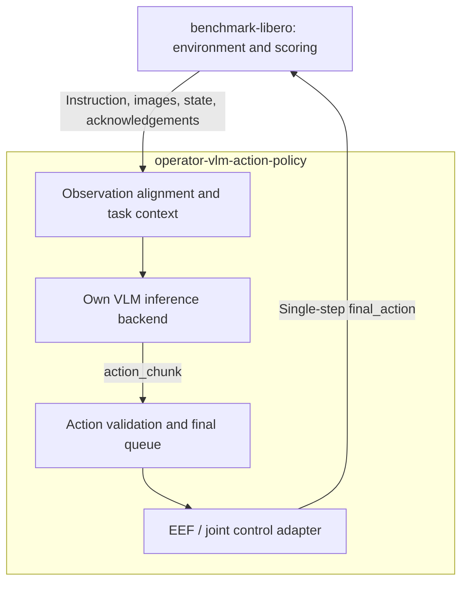
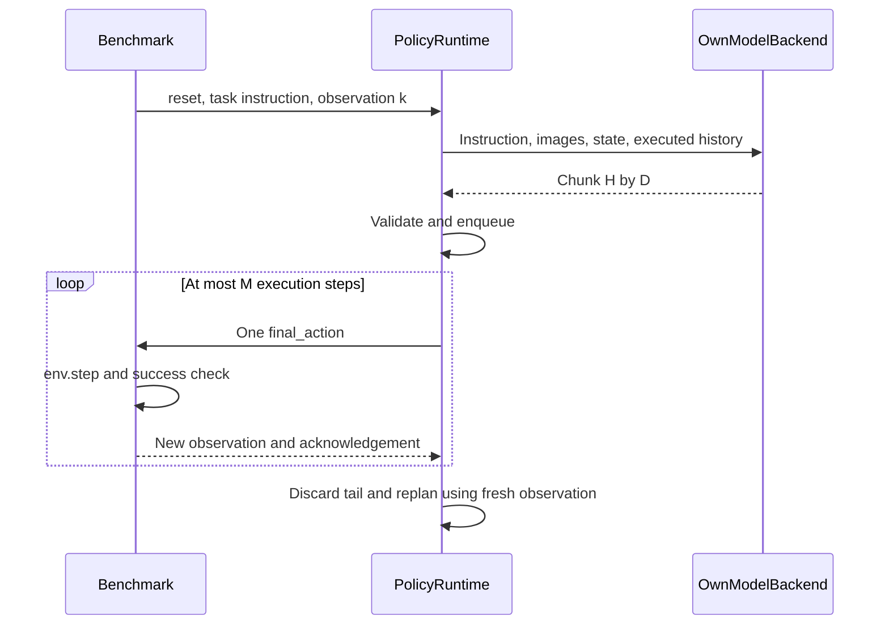
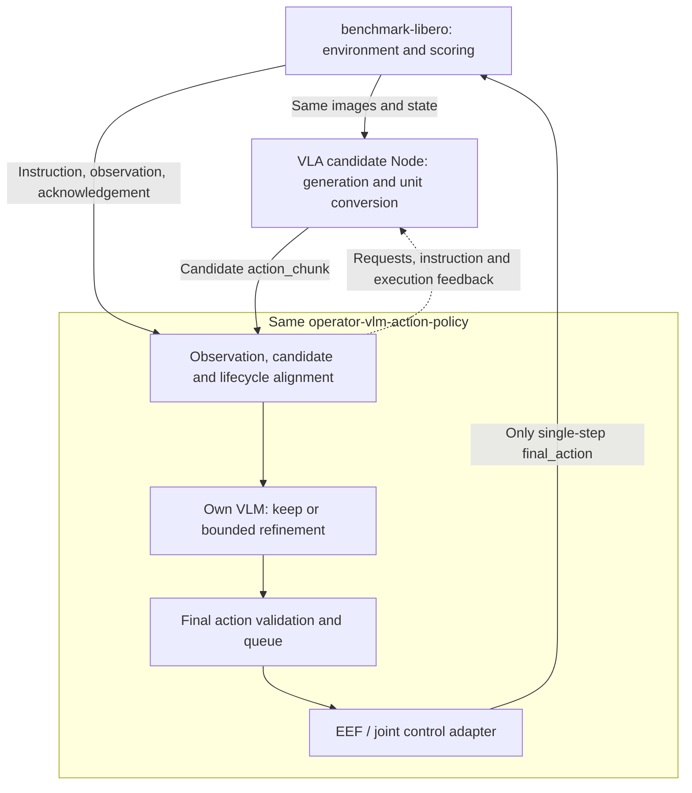
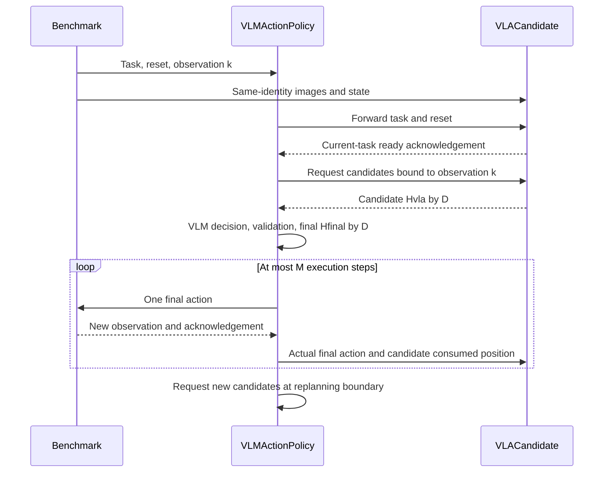

English | [简体中文](DESIGN_zh.md)

# VLM action-policy design

Use the same `operator-vlm-action-policy` Node for **standalone VLM control** and **VLA + VLM control**, packaged as benchmark Skill profiles.

The Node owns its model API client or in-process local model. It does not depend on the existing operator-vlm-policy service. **This is a design proposal, not an implementation.**

## Scenario A: standalone VLM

The VLM generates an action chunk from the task, images and robot state, then sends actions to the environment one step at a time.

### Architecture

There are two business Nodes. Observation management, model backend, queue and adapter are **modules inside the VLM action Node**, not separately deployed Nodes. The backend directly accesses a model API or loads a local model in-process.

| Node | Inputs | Outputs | Responsibility |
|---|---|---|---|
| Benchmark | Single-step action | Task, images, state, execution feedback, results | Run simulation, advance environment, score success |
| VLM action policy | Task, images, state, execution acknowledgement and lifecycle commands | Chunk, single-step final actions, policy state/errors | Align observations, maintain context, infer, validate, queue and adapt actions |

### Dataflow and execution sequence

H is the generated horizon, D is the row width, and M is the maximum control steps executed before replanning.

**Example:** generate four steps and execute two. Every step waits for a new environment observation. Replan after the second step, discarding the original third/fourth steps. Runtime and model backend in this sequence belong to the same policy Node.

Ticks schedule work without granting extra action steps. Model calls can operate on chunks; lockstep simulation pauses while waiting, so model wall-clock latency and environment control period are different quantities.

### Important configuration

| Important setting | Meaning | Example |
|---|---|---|
| mode | Standalone control | standalone |
| model.backend | Backend owned directly by this Node | Provider API or in-process local model |
| action.space / dimension | Action type and row width | EEF delta / 7 |
| action.prediction_horizon | Steps generated per inference | 4 |
| action.execute_horizon | Maximum steps before replanning | 2 |
| action.frame / action.control_dt_s | Reference frame and step period | world / 0.05 seconds |
| runtime.inference_deadline_ms | Model request wait limit | 60000ms example budget |

Full drafts: [policy](../examples/libero/policy.yaml) · [dataflow](../examples/libero/dataflow.yaml) · [benchmark](../examples/libero/benchmark.yaml).

## Scenario B: VLA proposes, VLM decides

VLA supplies candidate actions. The VLM keeps or refines them using the same task and observations. Reuse the VLM action Node from A.

### Architecture

There are three business Nodes. VLA proposes candidates; the VLM action Node owns final decisions and execution. Candidate actions cannot bypass it to reach the environment.

| Node | Inputs | Outputs | Responsibility |
|---|---|---|---|
| Benchmark | Single-step action from the VLM Node | Task, images, state, execution feedback, results | Run simulation and score success |
| VLA candidate policy | Task, images, state, requests, actual execution feedback | Candidate chunk and current-task readiness | Generate on request, convert to the declared action semantics, update history from actual execution, no direct control |
| VLM action policy | Candidate, task, images, state, readiness and execution acknowledgements | Final chunk, single-step actions, candidate requests, execution feedback and decision trace | Align inputs, keep/refine, validate and own final execution; forward lifecycle commands |

### Dataflow and execution sequence

**Example:** VLA proposes eight steps, VLM forms four final steps, and two are executed before replanning. Candidate length, final length and execution length are independent parameters.

VLA receives the actual final actions, never assuming that its entire original candidate was executed. Bind the candidate and images/state to the same task/control step to prevent old plans being applied to new scenes.

Initially allow **retention or bounded refinement**, preserving VLA gripper commands by default. Start with the serial candidate→VLM decision→execution baseline. Evaluate async prefetch and full replanning separately later.

### Important configuration

| Important setting | Meaning | Example |
|---|---|---|
| mode | Use VLA candidates | vla_conditioned |
| candidate.expected_horizon | Candidate steps from VLA | 8 |
| action.prediction_horizon | Final steps formed by VLM | 4 |
| action.execute_horizon | Maximum executed prefix | 2 |
| candidate.dimension / action.dimension | Candidate/final row width | Initially both 7 with matching semantics |
| refinement.strategy | Candidate treatment | bounded_residual |
| refinement.allow_gripper_override | Allow gripper changes | false by default |
| candidate.deadline_ms / candidate.on_timeout | Candidate wait budget and failure action | 3000ms / abort evaluation |

Candidate chunks, requests and feedback require VLA-runner extensions. VLA must not independently dequeue or write environment actions. Match observations and candidates using the same episode/step identity.

Full drafts: [final policy](../examples/vla_vlm/policy.yaml) · [VLA](../examples/vla_vlm/vla.yaml) · [dataflow](../examples/vla_vlm/dataflow.yaml) · [benchmark](../examples/vla_vlm/benchmark.yaml).

## Shared rules

- **Environment inputs are single-step.** Manage chunks inside the policy and consume them using fresh observations.
- **Horizons and dimensions are configurable with explicit semantics.** EEF delta typically has 7 values; position, quaternion and gripper has 8; N joints plus gripper usually has N+1. Changing width alone does not convert types.
- **Default LIBERO uses EEF controls.** Joint output needs genuine joint state and a matching controller; see the [joint draft](../examples/joint/policy.yaml).
- **Reset clears the whole policy chain.** Invalidate queues, context and late results. History includes only acknowledged execution.
- **Account for failures explicitly.** Timeout/invalid actions default to evaluation abort, without hidden fallback. Benchmark owns success scoring.

Main/wrist images use image/*, state uses proprio_state, tasks/reset use policy_command, and logical final actions use the action port. Complete wiring is specified by each draft dataflow.

Acknowledgements represent completion of the corresponding environment step. Their identity contract still needs integration work; receiving an arbitrary new image is insufficient proof of execution.

Freeze control period, units, frame, gripper convention, limits and timeouts in configuration. Model denormalization and controller scaling are separate operations. See [interface notes](CONTRACTS.md) for the detailed contract.
