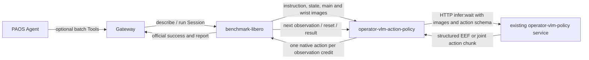
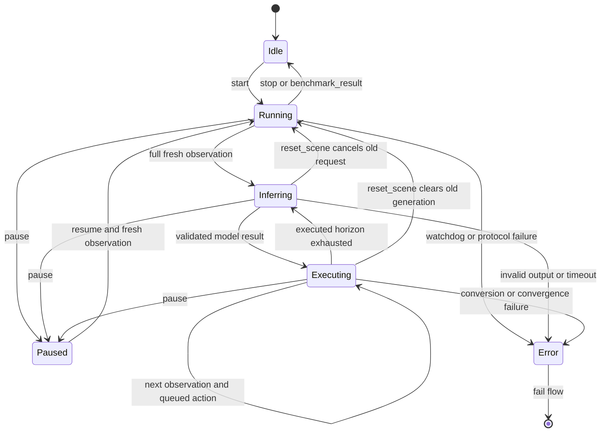

English | [简体中文](DESIGN_zh.md)

# VLM action policy and benchmark Skill design

## 1. Scope and implementation status

`operator-vlm-action-policy` is an internal, persistent compute Node. It accepts observations and lifecycle commands, calls the existing generic `operator-vlm-policy` service, validates structured model output, and emits action chunks plus one native action per new observation. No Agent is required in the per-step loop. It does not train an action head or establish model control accuracy.

Implemented: async generic-service client; EEF delta, EEF pose and joint-position output; bounded pose servo; step credits; chunk consumption; execution-feedback history; lifecycle commands; reset generation invalidation; watchdog; public Forge Arrow carriers; legacy LIBERO and strict observation-v1 input drivers. Tests use controlled model responses and transport fixtures.

Not established: real-model LIBERO success rate, actual LIBERO simulator acceptance, physical robot safety, whole-robot collision checking, IK, or Forge 2/Dora 1 deployment. Joint output requires a matching joint controller and real joint observations. The upstream default LIBERO profile accepts EEF actions only.

## 2. Overall flow



- Autorun example: two Dora Nodes (benchmark + action policy), one separately managed HTTP VLM service. The model provider may be remote or local behind that service.
- PAOS Tool-controlled Skill: three Dora Nodes including Gateway; the same HTTP service. The policy Node adds no ToolEndpoint and no HTTP listener.
- Production Node count owned by this repository: one. Example launchers and packaging helpers add no inference Node.
- Optional Gateway routes the benchmark's `benchmark.controller` Endpoint: `describe` Query and `run` Session. Suggested Skill Tool IDs: `vlm_libero.benchmark.describe` and `vlm_libero.benchmark.run`. They are deployment bindings, not new policy operations. Session acceptance is not completion, and batch completion does not mean 100% task success.

## 3. Node inputs and outputs

| Component | Inputs | Outputs | Owner |
|---|---|---|---|
| benchmark-libero | `action`: native 7D JointCommand; optional `tool_in` | `proprio_state`, `image/main`, `image/second`, `policy_command`, `benchmark_status`, `benchmark_result`; optional `tool_out` | Environment reset/step, task plan, official success, video/results |
| action policy | `tick`, `policy_command`, `proprio_state`, configured `image/*`, `benchmark_result`; alternatively `observation` | `action`: Forge-compatible JointCommand plus identity metadata; `action_chunk`: JSON; `policy_state`: JSON; `policy_error`: JSON | Inference scheduling, action contract, execution queue, stale result rejection |
| generic VLM service | HTTP `/v1/infer:wait`: messages with text/image blocks, context, response_format, limits | `vlm.infer.result.v1`, including `execution_status`, `output.json`, provenance/usage | Model routes, credentials, image import, generic inference/context storage |
| optional Gateway | Agent Tool requests, benchmark tool responses | Benchmark Tool requests, Agent responses | Query/Session routing and invocation lifecycle |

`action`, `action_chunk` and `policy_state` are stream outputs; they are not Tool operations. Model and provider effort remain configured in the generic service. `model_route` may select an existing route; this repository never silently replaces its model or effort.

## 4. Observation contract

The recommended application envelope is `Observation` in `contracts.py`:

- `episode_id`, `epoch`, `step_id`, `obs_id`: explicit correlation identity.
- `state`: finite numeric values, interpreted by `state_names` and `state_semantics`.
- `images`: camera alias → `{mime_type, data}` with base64 image bytes.
- Instruction is supplied through `PolicyCommand(set_instruction)`; `reset_scene` establishes a fresh episode.

Two drivers are implemented:

1. `legacy_libero`: works with the upstream separate Image/JointState ports. Collect one fresh message from every configured camera and state after each bundle. Wait for a full fresh bundle before sending the next action. Reset uses the Dora transport timestamp watermark to discard older samples and retain newer samples already delivered on another port. Identity is generated locally. This assumes a single producer/writer, ordered per-port delivery and no old cross-port messages after reset. It cannot prove atomic camera/state capture or reject every delayed previous-episode frame; that limitation is reported in `policy_state`.
2. `observation_v1`: one Arrow string containing the complete JSON envelope. `reset_scene.inputs` must contain `episode_id` and integer `epoch`; old identities and step gaps are rejected. The producer must implement this envelope and validate outgoing action correlation. Upstream benchmark-libero does not yet provide this port; connecting it requires a benchmark-side extension. It is not enabled by the provided upstream-compatible dataflow.

The legacy LIBERO state is **EEF position(3) + axis-angle(3) + finger positions(2)**. Its `joint1..joint7, gripper` labels are historical carrier labels. They are not seven measured arm joint angles. Joint profiles require genuine joint positions in configured order.

Raw RGB8/BGR8 Forge Image is supported, including row padding. It is encoded as PNG and sent using the generic service's existing `inline_base64` image blocks. No filesystem sharing is required; object ground truth, simulator state vectors, evaluator predicates and privileged poses are not included in the prompt. Use benchmark images as supplied: do not repeat its image flipping.

## 5. Action contract and execution

Model JSON has `action_space`, `frame`, `actions`. The runtime binds it to the actual request observation and publishes `vlm.action_chunk.v1` with episode identity, source step/observation, chunk ID, configured `dt_s`, execute horizon and model provenance.

| Space | Per-row dimensions | Meaning | Native output |
|---|---|---|---|
| `eef_delta` | 7 | world translation in metres, world rotation vector in radians, normalized gripper | LIBERO OSC normalized 7D action |
| `eef_pose` | 8 | world position in metres, unit quaternion **xyzw**, normalized gripper | Recompute bounded OSC delta from each new measured EEF pose |
| `joint_position` | N+1 | N absolute joint positions in radians, normalized gripper | N+1 position vector with configured names |

The implemented LIBERO EEF adapter requires `frame: world`. `robot_base` is reserved in the vocabulary and rejected by this adapter; transforms are not guessed. The model has no direct actuator authority: all results undergo dimension, finite-value, action-space, frame, gripper and configured bound checks. A native `JointCommand` carrying EEF controls remains an EEF action semantically.

EEF deltas are bounded by translation/rotation vector norms. Native normalization uses configured translation/rotation scales; the example uses 0.05 m and 0.5 rad, matching the referenced OSC configuration. Confirm the installed controller's scaling/frame/gripper convention before an evaluation. Workspace checks constrain target/next-command EEF positions and provide no swept-volume collision guarantee.

EEF-pose waypoints remain queued until the latest measured pose is within position/orientation tolerances; they are bounded by `max_servo_steps`. Rotation uses shortest quaternion error `log(R_target R_current^-1)`. The gripper command is sent even when a waypoint is already within tolerance. Pose waypoint timing is feedback-driven; `dt_s` denotes environment step time and is not a promise that an absolute target is reached in one step.

Joint output validates position bounds and the maximum change relative to current measured joints. The receiving controller must implement the declared absolute joint-position and normalized gripper contract. There is no automatic conversion from joint targets to LIBERO OSC actions. Upstream LIBERO currently truncates action input to seven values, so a Panda 7+gripper joint route requires a different controller and benchmark action adapter. EEF→IK→joint can later be added as an explicit adapter with its own kinematics, solver failure and residual contract; it is not implemented here.

## 6. Resident state and control flow



`tick` pumps asyncio and schedules work; it does not grant another environment step. Every complete fresh observation grants exactly one action credit. While inference is pending, the simulator remains paused under the benchmark's lockstep loop. Wall-clock latency and simulation time must be reported separately.

The model may generate H rows; only the first M=`execute_horizon` are queued. For EEF delta and joint modes, each row consumes one credit. Pose rows may consume several credits until convergence. The unused tail is discarded rather than silently replayed after a reset or new plan.

Lifecycle commands: `start`, `pause`, `resume`, `stop`, `reset`, `reset_scene`, `set_instruction`. Policy IDs must match; `*` is accepted as an explicit broadcast. Instruction replacement/reset/pause/stop cancels the local inference, attempts remote request cancellation, clears cached observations, chunk queues and history, and invalidates old results. `reset_scene` keeps a running policy running; `reset` returns it to idle. The Node remains resident between normal episodes and benchmark batches; final benchmark results leave it idle.

The next model input includes only bounded history acknowledged by subsequent observations, never an unexecuted model tail. Legacy observation arrival is an acknowledgement proxy; strict correlation requires the observation-v1 producer extension. Generic requests are stateless; episode history is managed explicitly in this runtime and cleared at boundaries. No hidden persistent model conversation crosses evaluation episodes.

Invalid output, protocol error, watchdog timeout or pose nonconvergence emits `policy_error` and terminates the flow, sending no invented fallback movement. Existing upstream benchmark has no policy-error/abort input and its Session stop waits for an episode boundary. Orchestration must treat an interrupted batch as an infrastructure/policy failure and retain incomplete scheduled episodes; it must not claim successful completion or silently drop them. A future structured abort input belongs to the benchmark integration, not to generic infer.

## 7. Dataflow and deployment

The complete two-Node autorun sample is [examples/libero/dataflow.yaml](../examples/libero/dataflow.yaml), with [benchmark config](../examples/libero/benchmark.yaml) and [policy config](../examples/libero/policy.yaml). Replace `/opt/...` paths, install LIBERO/robosuite in the benchmark environment, start the existing VLM service separately, then:

```yaml
# Replace executable paths and benchmark checkout path. Run from this directory.
# LIBERO main e1eb5b6 uses Dora 0.4.1. Both processes AND the Dora CLI must match.
# Start the existing operator-vlm-policy HTTP service separately before this flow.
nodes:
  - id: libero_benchmark
    path: ./benchmark.sh
    env:
      BENCHMARK_CONFIG: ./benchmark.yaml
      LIBERO_PYTHON: /opt/libero-env/bin/python
      LIBERO_NODE_ROOT: /opt/benchmark-libero
      MUJOCO_GL: egl
      PYOPENGL_PLATFORM: egl
    inputs:
      action:
        source: vlm_policy/action
        queue_size: 1
    outputs: [proprio_state, image/main, image/second, policy_command, benchmark_status, benchmark_result]

  - id: vlm_policy
    path: ./policy.sh
    env:
      VLM_ACTION_PYTHON: /opt/vlm-action-env/bin/python
      VLM_ACTION_CONFIG: ./policy.yaml
    inputs:
      tick: dora/timer/millis/20
      policy_command:
        source: libero_benchmark/policy_command
        queue_size: 32
      proprio_state:
        source: libero_benchmark/proprio_state
        queue_size: 1
      image/main:
        source: libero_benchmark/image/main
        queue_size: 1
      image/second:
        source: libero_benchmark/image/second
        queue_size: 1
      benchmark_result: libero_benchmark/benchmark_result
    outputs: [action, action_chunk, policy_state, policy_error]
```

```bash
uv sync --frozen --all-extras --group dev
uv run operator-vlm-action-policy validate --config examples/libero/policy.yaml
uv run operator-vlm-action-policy schema --config examples/libero/policy.yaml
cd examples/libero
dora run dataflow.yaml
```

The policy Node command is `operator-vlm-action-policy run --config policy.yaml`. Initial models are loaded/selected by the existing generic service. The policy does not expose its own model-management Tool. Pin the HTTP service, node revision, LIBERO/robosuite/controller configuration and Dora CLI/runtime together.

The sample targets upstream benchmark-libero revision `e1eb5b6c398c04065911336075efe30091d9570c`: Dora 0.4.1 and public Forge message field contracts. The action Node avoids a full forge-msgs dependency by implementing the narrow public Arrow fields itself; it requires patched Pillow 13 for PNG encoding. No SDK modules are copied. Forge 2/Dora 1 migration needs a separately validated environment and profile; this lock does not claim that compatibility.

## 8. PAOS Skill packaging plan

The repository provides [examples/skill](../examples/skill) as a source template: manifest, SKILL instructions, launchers, three-Node Tool dataflow and Gateway bindings. These files follow the existing PAOS example pattern. They are not an installed or accepted Skill artifact. PAOS manifest expansion, Gateway version and actual Session interoperability must be validated in the selected runtime before release.

The Skill owns this sequence:

1. Resolve pinned policy/benchmark/Gateway artifacts and required environments; verify VLM service readiness.
2. Start one resident dataflow; query `benchmark.controller/describe` for actual task/init-state limits.
3. Start a `run` Session for a fixed evaluation plan; monitor status without participating in per-step action choice.
4. Retrieve terminal result, official success report, actions/model provenance and optional video.
5. Stop at an episode boundary on user request; classify hard interruption/timeouts separately.

Skill configuration contains prompts, action schema/controller parameters and environment mapping. Credentials stay in deployment environment/service configuration. Do not bundle model keys, provider files, benchmark datasets or weights.

## 9. Evaluation and acceptance

Acceptance must cover three distinct levels:

- Protocol/runtime: real generic-service envelope interoperability, one action per observation, reset cancellation, physical units/scaling, pose servo and joint limits.
- Simulator integration: real Dora + LIBERO, native action dimensionality, camera orientation, official success predicate, reset/batch completion, report/video persistence and interruption accounting.
- Model capability: fixed tasks/init states, repeated episodes, actual configured model/effort, frozen prompt/action adapter, measurable success and cost.

Record task-level and overall success, termination reasons, scheduled/completed episodes, environment steps, simulation time, wall-clock time, model calls and p50/p95 latency, token usage and billable cost only with pricing evidence. Keep invalid outputs, timeouts and infrastructure errors visible. RGB-only, depth-assisted and grounding-assisted policies are separate profiles. Changing controller/joint space changes the evaluation protocol and must be reported separately from the default LIBERO OSC route. Do not use a VLM's self-reported completion as official benchmark success.

## 10. Primary references

- [benchmark-libero](https://github.com/PhyAgentOS/benchmark-libero), especially `_core/runner.py`, `adapters/libero_adapter.py`, `dataflow.example.yaml` and `bench_tool/descriptor.py`.
- [LIBERO environment wrapper](https://github.com/Lifelong-Robot-Learning/LIBERO/blob/master/libero/libero/envs/env_wrapper.py).
- [robosuite 1.4.1 OSC configuration](https://github.com/ARISE-Initiative/robosuite/blob/v1.4.1/robosuite/controllers/config/osc_pose.json).
- [Forge public message fields](https://github.com/PhyAgentOS/forge/tree/master/packages/msgs/src/forge_msgs).
- [operator-vlm-policy](https://github.com/PhyAgentOS/operator-vlm-policy).
