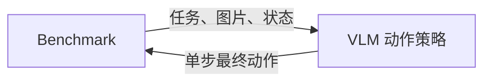
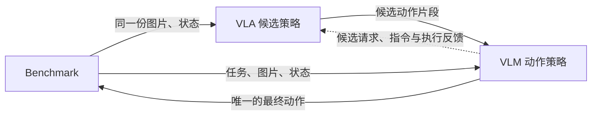

[English](DESIGN.md) | 简体中文

# VLM 动作策略设计

目标：用同一个 `operator-vlm-action-policy` 节点，支持 **VLM 独立控制**和 **VLA + VLM 组合控制**，最终封装成 benchmark Skill。

节点自行接入模型 API 或加载本地模型，不依赖已有 `operator-vlm-policy` 服务。**本文仅为设计，尚未实现。**

## 方案 A：VLM 独立控制

VLM 根据任务、图片和机器人状态生成一段动作，再逐步发送给环境。

| 节点 | 输入 | 输出 | 职责 |
|---|---|---|---|
| Benchmark | 单步动作 | 任务指令、图片、机器人状态、评测结果 | 运行仿真、推进环境、判定成功 |
| VLM 动作策略 | 任务指令、图片、机器人状态 | 动作片段、逐步输出的最终动作 | 调用模型、检查动作、管理动作队列 |

**运行方式：** 收到观测 → 生成动作片段 → 执行前几步，每步等待新观测 → 再次规划。生成的剩余动作在重规划时丢弃。

| 关键配置 | 含义 | 示例 |
|---|---|---|
| `mode` | 独立控制 | `standalone` |
| `model.backend` | 节点直接使用的模型后端 | 模型 API 或进程内本地模型 |
| `action.space` / `dimension` | 动作类型和每步维数 | EEF 增量 / 7 |
| `action.prediction_horizon` | 一次生成多少步 | 4 |
| `action.execute_horizon` | 重新规划前最多执行多少步 | 2 |

完整草案：[策略配置](../examples/libero/policy.yaml) · [dataflow.yaml](../examples/libero/dataflow.yaml) · [benchmark 配置](../examples/libero/benchmark.yaml)。

## 方案 B：VLA 提候选，VLM 做最终决策

VLA 先给出候选动作，VLM 结合相同的任务和观测，决定保留或修正。复用方案 A 的 VLM 动作节点。

| 节点 | 输入 | 输出 | 职责 |
|---|---|---|---|
| Benchmark | VLM 节点输出的单步动作 | 任务、图片、状态、评测结果 | 运行仿真并判分 |
| VLA 候选策略 | 任务、图片、状态、候选请求、执行反馈 | 候选动作片段 | 按请求生成候选，不直接控制环境 |
| VLM 动作策略 | VLA 候选片段、任务、图片、状态 | 最终动作片段、单步动作、执行反馈 | 保留或修正候选，统一管理最终执行 |

**运行方式：** 收到观测 → 请求 VLA 候选 → VLM 保留或修正 → 校验 → 逐步执行 → 将实际执行结果反馈给 VLA → 再次规划。

首版建议只允许**保留候选或有界修正**，夹爪默认沿用 VLA 命令。完整重规划以后单独评测。

| 关键配置 | 含义 | 示例 |
|---|---|---|
| `mode` | 使用 VLA 候选 | `vla_conditioned` |
| `candidate.expected_horizon` | VLA 一次提供多少步 | 8 |
| `action.prediction_horizon` | VLM 最终形成多少步 | 4 |
| `action.execute_horizon` | 重新规划前最多执行多少步 | 2 |
| `candidate.dimension` / `action.dimension` | 输入与最终动作维数 | 首版都为 7，且语义一致 |
| `refinement.strategy` | VLM 如何处理候选 | `bounded_residual`，有界修正 |
| `refinement.allow_gripper_override` | 是否允许改夹爪命令 | 默认 false |

候选片段、候选请求和执行反馈需要扩展现有 VLA runner。VLA 不能自行消费队列或同时向环境发动作；观测与候选必须通过同一 episode/step 身份对齐。

完整草案：[最终策略配置](../examples/vla_vlm/policy.yaml) · [VLA 配置](../examples/vla_vlm/vla.yaml) · [dataflow.yaml](../examples/vla_vlm/dataflow.yaml) · [benchmark 配置](../examples/vla_vlm/benchmark.yaml)。

## 两种方案共用的规则

- **环境只接收单步动作。** action_chunk 留在策略内部管理，按新观测逐步消费。
- **步数和维数可配置，但动作语义必须明确。** EEF 增量通常为 7 维，位置加四元数及夹爪为 8 维，N 个关节加夹爪通常为 N+1 维；改变维数不能自动转换动作类型。
- **默认 LIBERO 使用 EEF 控制。** joint 输出需要真实关节状态和匹配的关节控制器；[关节配置草案](../examples/joint/policy.yaml)单独提供。
- **reset 清理整条策略链。** 清空动作队列与上下文，丢弃旧任务的迟到结果；历史只记录已确认执行的动作。
- **失败要明确记账。** 超时或非法动作默认中断评测；不静默回退。成功与否由 benchmark 判定。

控制周期、单位、坐标系、夹爪方向、动作限位和超时也要固定在配置中。模型去归一化与环境控制器缩放须分别处理。详细约定见[接口说明](CONTRACTS_zh.md)，主文档不展开协议字段。

## Skill 封装与评测

Skill 提供 `vlm_only` 和 `vla_vlm` 两个 profile，打包对应的 dataflow、模型参数、prompt、动作约定与评测配置。方案 A 为两个业务节点，方案 B 为三个；需要 Agent 通过 Tool 启动评测时，各增加一个 Gateway。

Agent 负责启动批次和读取结果，节点内部完成逐步控制。Gateway 复用 benchmark 的 `describe` / `run`，不参与动作选择。

先比较三组：**VLA 基线、方案 A、方案 B**。固定任务与初始状态，记录成功率、环境步数、实际耗时、推理消耗；方案 B 额外记录修正率和回退率。

建议先确认并完成方案 A 的闭环，再增加 VLA 候选接口验证方案 B。上述配置数值仅为示例，尚未实现或验证性能。

参考：[benchmark-libero](https://github.com/PhyAgentOS/benchmark-libero) · [operator-lerobot-runner](https://github.com/PhyAgentOS/operator-lerobot-runner)。
