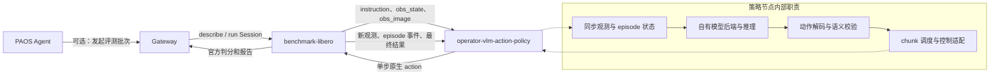
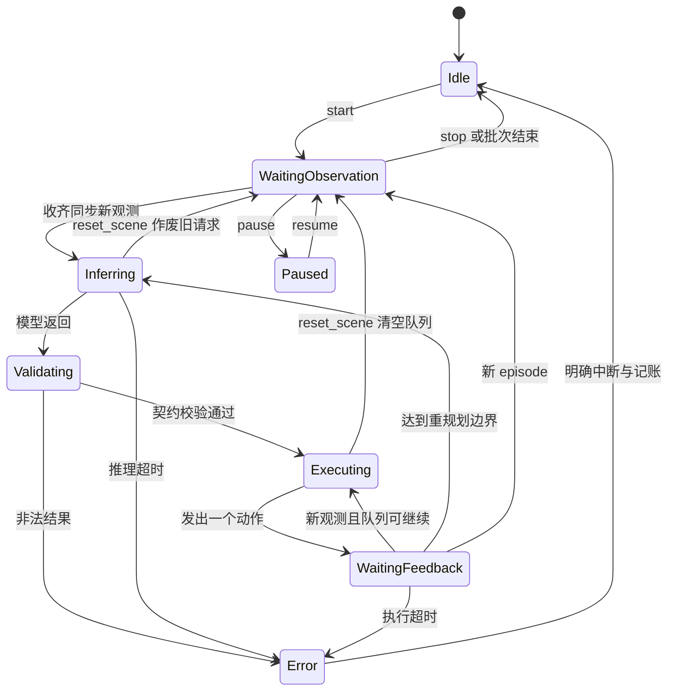

[English](DESIGN.md) | 简体中文

# 独立 VLM 动作策略与 benchmark Skill 方案

## 1. 本次范围与边界

本次仅确定方案，不开发实际代码。`operator-vlm-action-policy` 定位为独立、内部常驻的策略节点，承担从图片、状态、任务指令到动作片段的完整策略过程，接口角色与 VLA policy 对齐。

**节点自身负责模型后端接入、输入组装、推理和动作解码，不调用现有 `operator-vlm-policy` HTTP 服务。** 可以直接调用配置中的模型供应方 API，或在节点进程内加载本地模型；后端选择属于该节点自己的模型配置。API 模式也不需要额外部署一个 PAOS 通用 VLM 服务。

以下节点、端口、状态及配置均为设计目标。没有已实现能力、实测成功率或安装验收的声明。仓库中的 YAML 是方案样例，不是可直接启动的实现。

## 2. 整体流程图



最小评测闭环：**两个业务节点**，benchmark 和动作策略。Agent 通过 Tool 管理评测时增加 Gateway，形成三个 Dora 节点。模型供应方 API 属于外部模型后端；本地模型模式可在策略节点进程内运行。没有额外 `operator-vlm-policy` 服务或 bridge 节点。

同步、推理、解码、队列和控制适配都是动作节点内部模块，不分别拆为数据流节点。模型能力的识别、动作生成、复核可以通过同一策略中的 prompt/上下文表达；MVP 不增加独立 grounding 节点。

## 3. 每个节点输入输出

| 节点 | 输入 | 输出 | 所有权与职责 |
|---|---|---|---|
| benchmark-libero | `action`；可选 Tool `tool_in` | `proprio_state`、`image/main`、`image/second`、`policy_command`、`benchmark_status`、`benchmark_result`；可选 `tool_out` | 独占环境 reset/step、任务/初始状态计划、官方成功判定、录像和报告 |
| operator-vlm-action-policy（拟开发） | `tick`、`policy_command`、`proprio_state`、配置的 `image/*`、`benchmark_result` | `action`、`action_chunk`、`policy_state`、`policy_error` | 自有模型接入、观测同步、上下文、动作生成、校验、逐步执行调度 |
| Gateway（可选，复用已有） | Agent Tool 请求、benchmark Tool 响应 | benchmark Tool 请求、Agent 响应 | Query/Session 调用管理，不参与逐步动作决策 |

节点语义分工：benchmark 推进环境；策略节点提供唯一动作流；Agent 管理评测任务。策略输出 `action` 后，等待 benchmark 产生下一份观测，不自行调用另一个环境实例。

## 4. 输入契约

逻辑输入为：

```text
instruction
obs_image：主视角、腕部视角等
obs_state：机器人状态，具备明确维度、单位和坐标系
observation_identity：episode_id、epoch、step_id、obs_id、sim_time
execution_feedback：上一动作的实际回执、失败原因等
```

指令通过 `policy_command / set_instruction` 更新；图片和状态来自同一次环境观测。状态解释由控制 profile 明确，不能只根据向量维数猜测。

现有 LIBERO 的八维 `proprio_state` 是 **EEF 位置三维 + 旋转向量三维 + 双指位置二维**。其历史 `joint1..joint7, gripper` 名称是载体标签，不代表七个机械臂关节角。joint 输出模式必须增加或选用真实关节位置观测。

兼容方案分两步：

- 原型接入保留上游端口，在单生产者、单动作写入者、锁步假设下，收齐每一路新图片和新状态后推理。必须处理跨端口乱序，禁止 reset 后误用上一集的数据。仅缓存“最新值”不能证明同步。
- 正式方案要求 benchmark 为同一步的图片、状态附加共同的 episode/step 身份，或增加一个完整 observation 信封端口；策略与 benchmark 双向校验动作来源身份。当前上游未提供完整关联契约，这部分属于计划中的 benchmark 扩展。

不向策略暴露物体真值位姿、全仿真状态、官方判分谓词。增加深度、标定或额外视觉工具时应作为独立观测 profile 披露。

## 5. 动作输出契约

统一名称为 `action_chunk`。以下是应用层计划契约，不预设现有 Forge 已有同名消息。

```text
action_chunk：
  schema_version、chunk_id
  episode_id、epoch、source_obs_id、source_step_id
  action_space、frame、units、joint_names（关节模式）
  dt_s、actions[H,D]、execute_horizon
```

| 动作类型 | 每行内容 | 单位/约定 | 执行方式 |
|---|---|---|---|
| `eef_delta` | 平移增量 3 + 旋转增量 3 + 夹爪 1 | 米、弧度旋转向量、明确夹爪约定，声明坐标系 | 控制适配为环境的末端控制量 |
| `eef_pose` | 位置 3 + 四元数 4 + 夹爪 1 | 米、单位四元数 xyzw | 使用最新观测计算误差，逐步趋近目标 |
| `joint_position` | N 个关节位置 + 夹爪 | 关节名称顺序、转动关节弧度/移动关节米 | 送入匹配的关节位置控制器 |

优先把 `eef_delta` 接入默认 LIBERO；保留 `eef_pose` 和 `joint_position` 的通用契约。

**LIBERO 默认七维动作是末端平移/旋转控制量加夹爪，不是七个关节角。** `JointCommand` 的消息名称也不改变其真实控制语义。控制适配必须核对控制器类型、增量/绝对模式、输入缩放、参考坐标系、旋转组合方式和夹爪方向。

EEF→joint 的 IK 并非默认 LIBERO 路线的必要环节。使用关节控制器或真实机器人时，再由显式适配模块调用 IK，并验证模型、TCP、求解残差、关节限位和连续性。更换控制器及动作空间会改变测评协议，应单独报告。

模型输出必须经过维度、有限数值、单位、坐标系、步长、关节范围、工作空间和可达性等相应检查。需要碰撞保证时另行引入经过验证的碰撞检测/规划，不能将范围检查等同于运动安全。

## 6. 常驻状态与数据流



运行过程：

1. benchmark reset，建立 episode 身份，下发指令。
2. 策略清理上一集的队列、未完成请求和上下文，收齐当前观测。
3. 节点内部的模型后端接收图片、状态、指令、有限历史和动作输出契约。
4. 模型生成 H 步，校验后按配置只执行前 M 步；尾部丢弃。
5. 每份新观测只授予一个动作额度；输出一个动作后等待反馈，不能靠 tick 连发。
6. 根据新观测消费下一动作、维持位姿闭环，或重新规划。
7. benchmark 用官方谓词判分，结束当前集；策略清理状态后继续驻留，等待下一集或批次。

`tick` 是调度/异步结果检查信号，不意味着模型每 20ms 推理一次，也不意味着环境必须按实际时间连续推进。锁步模式下等待模型期间仿真暂停，实际耗时与仿真时间分别统计。

reset、任务切换、指令变更、暂停和停止都必须作废旧 generation。取消不能中止后端计算时，迟到结果也不得重填执行队列。异步预取属于后续优化，应先固定正确的同步基线。

模型上下文以 episode 为边界。只将已实际执行并收到回执的动作写入历史，不能把整段模型建议当成已执行事实。历史图片与记录应有显式保留策略；默认不跨评测 episode 共享会话，避免任务泄漏。

## 7. 错误与停止

非法 JSON、控制契约不符、推理超时、IK/可达性失败、执行超时分别记录，不自动转换成任意移动或静默零动作。模型的“任务完成”是一个预测，官方成功由 benchmark 判定。

当前上游 benchmark Session 的 stop 在 episode 边界生效，尚无完整的策略失败/立即中断协议。正式集成需设计结构化 `policy_error`→benchmark abort 或运行管理中断路线，确保处于等待动作的集能够失败收尾、结果落盘，而不是永久挂起。dataflow 草案暂不伪造上游不存在的 abort 输入。

## 8. dataflow.yaml 样例

下面保持参考仓库的已有 benchmark 端口，新策略节点及其入口均是未来设计。`/opt/nodes/...` 是制品占位路径，不能据此宣称可运行。实施前选择一致的 Dora/Forge 版本；参考仓库当前主分支使用 Dora 0.4.1，Forge 2 迁移属于另一条需验证的版本线。

```yaml
# DESIGN ONLY: operator-vlm-action-policy is a future artifact, not implemented here.
# Existing LIBERO port names follow the referenced benchmark-libero repository.
# Select one compatible Dora/Forge version for ALL artifacts before implementation.
nodes:
  - id: libero_benchmark
    path: /opt/nodes/libero_benchmark
    env:
      BENCHMARK_CONFIG: ./benchmark.yaml
      MUJOCO_GL: egl
      PYOPENGL_PLATFORM: egl
    inputs:
      action:
        source: vlm_policy/action
        queue_size: 1
    outputs:
      - proprio_state
      - image/main
      - image/second
      - policy_command
      - benchmark_status
      - benchmark_result

  - id: vlm_policy
    path: /opt/nodes/operator-vlm-action-policy
    args: --config ./policy.yaml
    inputs:
      tick: dora/timer/millis/20
      policy_command:
        source: libero_benchmark/policy_command
        queue_size: 32
      proprio_state:
        source: libero_benchmark/proprio_state
        queue_size: 1
      image/main:
        source: libero_benchmark/image/main
        queue_size: 1
      image/second:
        source: libero_benchmark/image/second
        queue_size: 1
      benchmark_result: libero_benchmark/benchmark_result
    outputs:
      - action
      - action_chunk
      - policy_state
      - policy_error
```

配套配置草案：[policy.yaml](../examples/libero/policy.yaml)、[benchmark.yaml](../examples/libero/benchmark.yaml)、[joint profile](../examples/joint/policy.yaml)。模型配置直接属于动作节点，没有 `service_url` 或通用 VLM bridge。

## 9. Skill 封装与 Tool

Skill 负责打包节点制品引用、dataflow、模型配置、prompt、动作 schema、控制 profile 和评测计划，不包含逐步自然语言控制循环。

计划内容：

```text
vlm-libero-benchmark/
  SKILL.md
  skill.yaml
  profiles/libero/
    dataflow.yaml
    gateway.yaml（Tool 控制批次时）
    benchmark.yaml
    policy.yaml
    control_profile.yaml
  schemas/
    observation.json
    action_chunk.json
```

Tool 控制版增加 Gateway，并启用 benchmark 已有 `benchmark.controller` Endpoint：

| 建议 Tool ID | operation | 语义 | provider |
|---|---|---|---|
| `vlm_libero.benchmark.describe` | `describe` | Query | benchmark-libero |
| `vlm_libero.benchmark.run` | `run` | Session | benchmark-libero |

策略节点初版不新增 ToolEndpoint。`start/set_instruction/reset_scene/stop` 等运行命令通过生命周期数据流传递。未来只有确有独立模型资源管理需求时，再评估策略管理 Endpoint。

Agent 使用 Skill 的流程：检查部署及模型就绪→describe 查询任务和限制→按确认的计划开启 run Session→查询状态→读取终态和报告。Session 接受不代表完成，批次运行成功也不代表任务成功率为 100%。凭据保留在部署环境，不打包密钥、模型权重或 benchmark 数据。

## 10. 测评与实施前需确认的事项

- 固定任务、初始状态、种子、模型/effort、prompt、图片处理、控制器、chunk 长度与消费长度。
- 记录官方逐任务/总体成功率、计划/完成集数、终止原因、环境步数、仿真时间、实际耗时、推理次数和延迟、token 消耗；费用需要价格依据。
- 非法动作、超时、中断和基础设施失败均保留，不能只统计完成的集。
- 先验收观测/动作契约与 reset，再验证真实 Dora+LIBERO，最后测模型能力。代码通过测试不能替代真实测评。
- 实施前确认首个模型后端（直接 API 或节点内本地推理）、Dora/Forge 版本、严格观测身份扩展、失败中断协议、joint 下游环境/控制器。

## 11. 参考

- [benchmark-libero](https://github.com/PhyAgentOS/benchmark-libero)：`_core/runner.py`、`adapters/libero_adapter.py`、`dataflow.example.yaml`、`bench_tool/descriptor.py`。
- [LIBERO 环境封装](https://github.com/Lifelong-Robot-Learning/LIBERO/blob/master/libero/libero/envs/env_wrapper.py)。
- [robosuite 控制器](https://robosuite.ai/docs/modules/controllers)。
