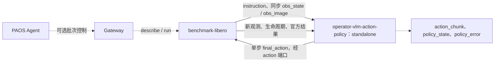
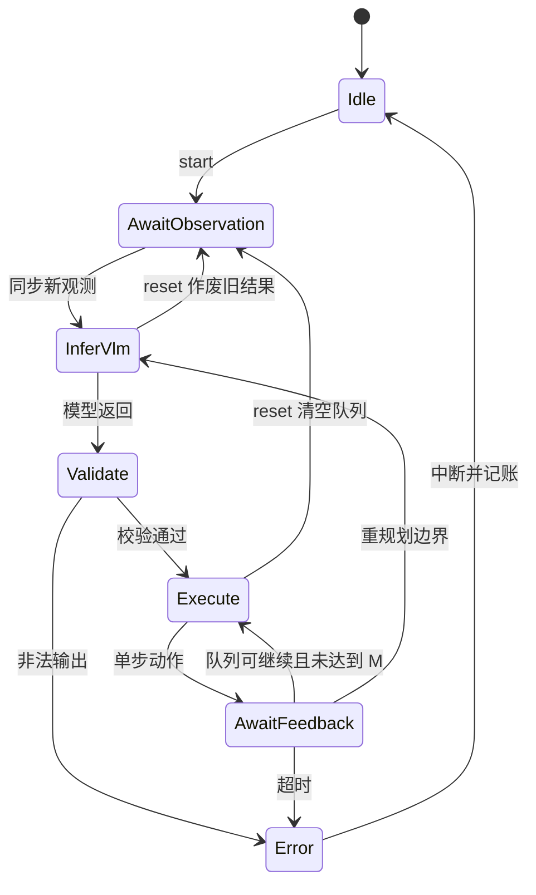
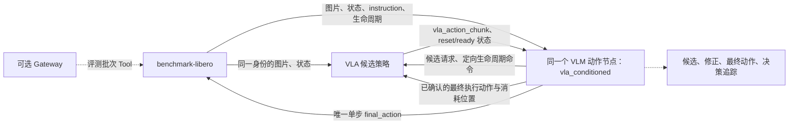
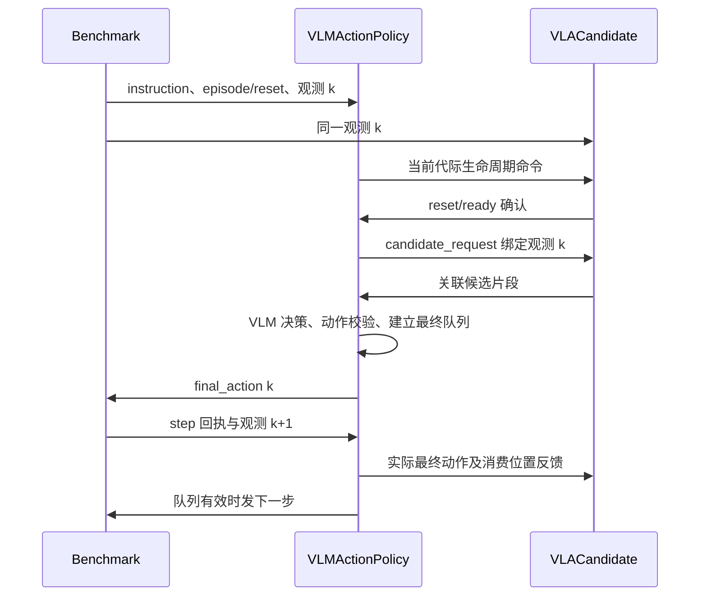

[English](DESIGN.md) | 简体中文

# VLM / VLA + VLM 动作策略与 benchmark Skill 完整设计

## 1. 设计范围与共同约束

本文将评测系统划分为两种方案：

| 方案 | 策略输入 | 最终动作来源 | 业务节点数，不含 Gateway |
|---|---|---|---|
| A：VLM 独立策略 | instruction、obs_state、obs_image | VLM 独立生成动作片段 | 2：benchmark + VLM 动作策略 |
| B：VLA + VLM 组合策略 | VLA 候选 action_chunk、instruction、obs_state、obs_image | VLM 保留、修正或重规划候选，统一输出 | 3：benchmark + VLA 候选策略 + 同一个 VLM 动作策略 |

两种方案复用同一个拟开发的 **`operator-vlm-action-policy`** 常驻节点。节点自身管理模型后端：直接接模型供应方 API，或在节点进程内运行本地模型。**不依赖现有 `operator-vlm-policy` 服务，不增加通用 VLM bridge。** 配置中的 `mode` 仅选择这个专用动作节点的输入组织和决策方式。

当前仅方案阶段。本文及 YAML 中的新节点、端口、参数、制品路径均是拟议契约，不代表已有实现。已有 benchmark 接口与需要扩展的接口在下文分别说明；不开展代码开发或运行验收。

两种方案共同遵守：benchmark 独占环境 reset/step 和官方判分；只有 VLM 动作节点连接 benchmark 的动作输入；模型生成片段，环境逐步消费动作；观测和动作均有 episode/step 身份；评测期间冻结模型、prompt、控制协议和动作参数。

## 2. 共用输入输出与动作契约

### 2.1 观测

逻辑输入为 `instruction`、`obs_state`、`obs_image`、`observation_identity`、`execution_feedback`。Dora 映射为 `policy_command`、`proprio_state`、`image/*`，并补充对应的身份/反馈信息。

| 字段 | 必须表达的内容 |
|---|---|
| 身份 | run_id、env_id、episode_id、epoch、obs_id、step_id |
| 时间 | sim_time、采集时间；控制步时间不能用模型返回时间代替 |
| 状态 | 值、字段语义、单位、坐标系，必要时真实关节名称顺序 |
| 图片 | 相机 ID、图像编码、分辨率、对应 obs_id |
| 指令 | instruction、instruction_version |
| 回执 | final_action_id、实际完成的控制步、执行结果、后续观测身份 |

当前 LIBERO 的八维 proprio_state 为 **EEF 位置 3 + 旋转向量 3 + 双指位置 2**。历史 `joint1..joint7, gripper` 标签不能当成七个机械臂关节角。joint 输出须使用真实关节状态。

A 可在原型阶段用现有端口做受限的 legacy 锁步接入；仅缓存各路“最新值”不证明原子同步。正式 A 和 B 均应为同一步图片、状态附加共同身份，或提供完整 observation 信封。当前 benchmark 尚无完整关联契约，需要明确扩展，不能只靠策略端猜测。B 默认要求严格关联，不能把 legacy 样例视为正式组合评测的同步保证。

### 2.2 action_chunk 与单步 final_action

```text
action_chunk:
  schema_version, chunk_id, policy_id
  episode_id, epoch, source_obs_id, source_step_id, instruction_version
  start_control_step, control_dt_s
  action_space, frame, dimension, layout, units
  joint_names, gripper_convention, normalization_profile
  actions[H,D]
```

上述是应用层设计契约，不声称已有同名 Forge 消息。H、D 均可配置，但必须与模型、解码、控制器匹配。

| 参数 | 含义 | 约束 |
|---|---|---|
| `vla.prediction_horizon`，H_vla | 上游候选步数，B 使用 | 与 candidate.expected_horizon 一致 |
| `action.prediction_horizon`，H_final | VLM 最终片段步数 | 初版按当前 profile 固定长度，输出长度严格校验 |
| `action.max_prediction_horizon` | 配置资源上限 | H_final 不超过此值，不表示任意变长输出 |
| `action.execute_horizon`，M | 重规划前最多执行的环境控制步数 | 固定步长动作下 1 ≤ M ≤ H_final；尾部丢弃 |
| `action.dimension`，D_model | 模型每行动作维数 | 与 space/layout/units/joint_names/夹爪编码一致 |
| `control_adapter.native_dimension`，D_native | 环境接收的每步维数 | 可以经显式适配而与 D_model 不同 |
| `action.control_dt_s` | 每个离散动作对应的控制周期 | 上下游一致，或有明确重采样适配 |

示例：H_vla=8、H_final=4、M=2、D_model=D_native=7。VLM 参考八步候选形成四步最终片段，只执行前两步后重新观察和规划。不能把“输入候选步数”“输出步数”“实际执行步数”当作一个参数。预训练 VLA 的原生 H/D 受 checkpoint 限制；配置须校验兼容性，必要的截取或重采样必须显式定义，不能靠改配置重塑动作头。

| action_space | 模型每行 | 语义 | 默认 LIBERO 路线 |
|---|---|---|---|
| `eef_delta` | 3 平移 + 3 旋转向量 + 夹爪，D=7 | 米、弧度、显式参考系 | 显式归一化为 OSC 七维输入 |
| `eef_pose` | 3 位置 + xyzw 四元数 + 夹爪，D=8 | 米、单位四元数 | 根据最新 EEF 状态转为七维 OSC 增量 |
| `joint_position` | N 关节位置 + 夹爪，通常 D=N+1 | 每关节声明 rad/m、名称顺序 | 要求匹配关节控制器，不能直接接默认 OSC |

默认 LIBERO 七维动作是末端控制量加夹爪；消息载体叫 JointCommand 也不会改变其语义。修改 D 不能自动转换 joint/EEF、坐标系或夹爪协议。默认 OSC 路线不需要额外 IK；EEF→joint 路线需显式运动学/控制适配及求解失败、残差、限位、连续性契约。

EEF 位姿目标不承诺一个控制周期内到达；如采用跨步位姿伺服，要按原生控制步记账并限制目标收敛步数。B 首版优先固定 control_dt_s 的 eef_delta 或 joint_position；非等时 waypoint 必须先定义时间参数化，不能按普通逐时刻候选片段直接融合。

逻辑输出 `final_action` 每次仅一控制步，在 dataflow 中使用 `action` 端口。`action_chunk` 用于片段与追踪，不能将整个 H×D 矩阵直接发送给 LIBERO，也不能连续灌入 H 条消息代替锁步。

## 3. 方案 A：VLM 独立策略

### 3.1 整体流程图



节点内部流程：同步观测→组装任务与已执行历史→自有 VLM 后端→动作解码/校验→最终队列→逐步输出。原型最小两个业务节点；Tool 控制版本增加 Gateway 后为三个 Dora 节点。没有独立 VLM 服务。

### 3.2 节点输入、输出和职责

| 节点 | 输入 | 输出 | 职责 |
|---|---|---|---|
| benchmark-libero | `action`；可选 `tool_in` | `proprio_state`、`image/main`、`image/second`、`policy_command`、`benchmark_status`、`benchmark_result`；可选 `tool_out` | 持有环境、推进单步、初始化任务/场景、官方判分、报告/录像 |
| VLM 动作策略，拟开发 | `tick`、`policy_command`、`proprio_state`、配置的 `image/*`、`benchmark_result` | `action`、`action_chunk`、`policy_state`、`policy_error` | 独立模型接入、观测对齐、生成 H_final×D、物理/语义校验、消费前 M 步、上下文与生命周期管理 |
| Gateway，可选已有组件 | Agent Tool 请求、benchmark Tool 响应 | benchmark Tool 请求、Agent 响应 | 批次调用管理，不决定每一步动作 |

### 3.3 单次闭环与状态

1. benchmark reset，发送 episode 身份及 set_instruction/reset_scene。
2. 策略作废旧请求/队列，等待完整新观测。
3. 模型产生配置形状的最终片段，校验后入队。
4. 每份新观测最多授予一次动作额度，发出一个原生 action。
5. 等待环境执行与下一观测；将已确认的实际动作加入历史。
6. 达到 M 步、队列失效或显式重规划条件后丢弃尾部，重新推理。
7. episode 结束清理上下文，进程继续驻留，等待下一集/批次。



### 3.4 配置文件与重要参数

完整草案：[policy.yaml](../examples/libero/policy.yaml)、[benchmark.yaml](../examples/libero/benchmark.yaml)。

| 文件/参数 | 示例 | 设计含义 |
|---|---|---|
| policy.mode | standalone | 不要求 VLA 输入 |
| model.backend / model_name_env / effort_env | provider_api / VLM_MODEL / VLM_REASONING_EFFORT | 由节点直接接入模型；本地模型是另一个后端选项 |
| observation.image_inputs / state_semantics | main、wrist；EEF 八维状态语义 | 定义观测，不从维度猜测含义 |
| observation.synchronization / require_identity | legacy_lockstep / false | 仅原型兼容；正式版本改为关联身份 |
| action.space / dimension / layout / units / frame | eef_delta / 7 / 明确各轴 / SI / world | 动作类型和维数绑定 |
| prediction_horizon / max_prediction_horizon / execute_horizon | 4 / 8 / 2 | 生成、资源上限和执行前缀独立配置 |
| control_adapter.native_dimension / scales | 7 / 0.05m、0.5rad | 示例值，须核对实际 OSC 控制器 |
| control_adapter.limits_source | robot_control_profile | 实施前提供经确认的步长、工作空间、关节限制与适用的伺服容差/超时 |
| runtime.tick_ms / inference_deadline_ms / feedback_timeout_ms | 20 / 60000 / 5000 | 调度、推理与执行等待预算，不构成实时保证 |
| context.scope / max_executed_history | episode / 4 | 有界已执行历史，禁止写入未执行尾部 |
| runtime.on_error / async_prefetch | abort_evaluation / false | 同步锁步基线；错误显式终止评测 |
| benchmark.policy_id | vlm_libero | 与最终策略身份一致 |
| benchmark.suite / task_ids / init_state_ids / num_runs / seed | 固定评测计划 | 决定任务集合和可比较性 |
| benchmark.control_mode / camera_* / max_steps | relative / 256 / 300 | 控制、观测和步数预算 |

### 3.5 dataflow.yaml 草案

保持已有 benchmark 端口，新策略入口是未来制品。所有 `/opt/nodes/...` 均为占位路径，不能据此启动实际节点。完整文件：[方案 A dataflow](../examples/libero/dataflow.yaml)。

```yaml
# DESIGN ONLY: operator-vlm-action-policy is a future artifact, not implemented here.
# Existing LIBERO port names follow the referenced benchmark-libero repository.
# Select one compatible Dora/Forge version for ALL artifacts before implementation.
nodes:
  - id: libero_benchmark
    path: /opt/nodes/libero_benchmark
    env:
      BENCHMARK_CONFIG: ./benchmark.yaml
      MUJOCO_GL: egl
      PYOPENGL_PLATFORM: egl
    inputs:
      action:
        source: vlm_policy/action
        queue_size: 1
    outputs:
      - proprio_state
      - image/main
      - image/second
      - policy_command
      - benchmark_status
      - benchmark_result

  - id: vlm_policy
    path: /opt/nodes/operator-vlm-action-policy
    args: --config ./policy.yaml
    inputs:
      tick: dora/timer/millis/20
      policy_command:
        source: libero_benchmark/policy_command
        queue_size: 32
      proprio_state:
        source: libero_benchmark/proprio_state
        queue_size: 1
      image/main:
        source: libero_benchmark/image/main
        queue_size: 1
      image/second:
        source: libero_benchmark/image/second
        queue_size: 1
      benchmark_result: libero_benchmark/benchmark_result
    outputs:
      - action
      - action_chunk
      - policy_state
      - policy_error
```

## 4. 方案 B：VLA 候选 + VLM 最终决策

### 4.1 整体流程图



三个业务节点；增加 Gateway 后为四个 Dora 节点。VLA 是候选动作生成者，VLM 节点是最终动作所有者。VLA 没有直连 benchmark 的 action 路线，也不自行消费候选队列。

### 4.2 节点输入、输出和职责

| 节点 | 输入 | 输出 | 职责 |
|---|---|---|---|
| benchmark-libero | 仅 `vlm_policy/action`；可选 Tool 输入 | 同 A 的观测/任务/结果；拟补共同身份元数据 | 推进唯一环境和官方判分，不融合策略动作 |
| VLA 候选策略，需适配 | `proprio_state`、`image/*`；VLM 转发的 `policy_command`；拟新增 `candidate_request`、`execution_feedback`；tick | 拟新增候选 `action_chunk`；`policy_state`、`policy_error` | 按请求生成 H_vla×D，完成自己的去归一化；确认 reset/ready；依据真实最终执行反馈维护历史 |
| VLM 动作策略，复用 A 的同一节点 | A 的输入；新增 `vla_action_chunk`、`vla_policy_state`、`vla_policy_error` | A 的输出；新增 `candidate_command`、`candidate_request`、`execution_feedback`、`decision_trace` | 对齐观测/候选，保留/修正/重规划，验证最终片段，独占执行队列与动作额度，给 VLA 提供真实执行反馈 |
| Gateway，可选已有组件 | 同 A | 同 A | 仅批次控制 |

上述候选片段/请求/执行反馈及 reset 确认接口是**拟新增 VLA runner 契约**。不能假定当前只输出单步 action 的 runner 已支持它们；它需要关闭原生动作发出与独立 dequeue，暴露消费前的原始片段。

### 4.3 候选与生命周期关联协议

| 消息 | 关键字段 | 规则 |
|---|---|---|
| candidate_command | target_policy_id（映射 PolicyCommand.policy_id）、episode_id、epoch、instruction_version、command | 最终策略将 benchmark 命令定向转发给 VLA，转换 policy_id，不依赖错误的同名广播 |
| policy_state 确认 | policy_id、episode_id、epoch、ready/reset 状态 | VLM 等待当前代际 reset/ready 确认，再请求候选 |
| candidate_request | request_id、source_obs_id、epoch、start_control_step、requested_horizon、deadline | 一次重规划只创建一个有效请求；VLA 必须绑定请求的完整观测 |
| VLA action_chunk | 共同 chunk 契约 + request_id | 候选来源、控制步、H、D、单位和 normalization profile 必须匹配 |
| execution_feedback | final_action_id、candidate_chunk_id、candidate_index、applied_final_action、ack_step、ack_obs_id | 只在执行确认后发送；VLA 根据实际最终动作更新历史，不能假定自己的原始候选都已执行 |

策略缓存按 obs_id 匹配。禁止给 VLM 一张较新的图，却把旧片段第一行当成当前动作。源观测步、候选预计起步位置、实际消耗位置分别记录。候选不一致时拒绝或重新请求，不靠截掉前几行猜测对齐。

### 4.4 决策、时序与超时

首版建议配置 `bounded_residual`：保留候选，或施加有界修正。decision_trace 至少记录 keep/refine/replan、候选 ID、修正量、实际输出和回退/拒绝原因。

- 平移修正要在相同单位/参考系下计算，并受范数与最终动作约束。
- 旋转修正按明确 SO(3) 组合；不能把一般旋转或四元数直接逐维相加。
- joint 修正要检查绝对限位和相对当前实测状态的步长。
- 夹爪是独立语义，初版默认透传 VLA，未经允许不做数值残差相加或覆盖。
- 完整重规划可作为后续单独评测的策略，不与有界修正混为同一个实验。

首版 keep/refine 要求 H_vla ≥ H_final ≥ M。keep 由节点截取已对齐候选的前 H_final 行；refine 返回最终 H_final×D，节点相对候选计算几何修正量并校验边界。模型可表达 replan 请求，但初版配置未启用的决策必须拒绝或记为显式中断，不能偷偷切换实验策略。

VLA 的模型统计去归一化与控制器缩放是两个步骤。若训练动作是归一化 OSC 输入，候选输出还需转成约定的米/弧度规范表示，再交给 VLM；最终执行时再映射到环境控制量。必须记录 normalization_profile，防止重复缩放或把无量纲值当米。

首版采用串行重规划基线：锁步暂停→收齐观测→等待 VLA 候选→VLM 决策→校验→执行前 M 步→再次重规划。VLM 按片段工作，每个控制步不强制重新推理。



候选请求只在当前代际 ready 确认后派发。未来异步优化必须限定结果提交到尚未执行的控制步，原子替换队列，过期结果丢弃。真实机器人实时控制不能仅由锁步仿真通过来推断。

超时默认 `abort_evaluation`，不静默退回 VLA。若后续引入 `keep_valid_candidate`，必须验证剩余片段的身份/有效期，显式配置并统计回退，不能宣称全程经过 VLM 审核。VLA 与最终动作空间、控制周期或归一化不同，须通过显式适配；首版要求同一契约。

### 4.5 配置文件与重要参数

完整草案：[最终策略 policy.yaml](../examples/vla_vlm/policy.yaml)、[VLA vla.yaml](../examples/vla_vlm/vla.yaml)、[benchmark.yaml](../examples/vla_vlm/benchmark.yaml)。

| 文件/参数 | 示例 | 设计含义 |
|---|---|---|
| policy.mode | vla_conditioned | 必须收齐有效 VLA 候选，再决策 |
| policy.policy_id / candidate.policy_id | vlm_libero_final / vla_libero_candidate | 最终执行者和候选者有独立身份 |
| observation.synchronization / require_identity | correlated_observation / true | 共同 episode/step 身份是组合方案前提 |
| candidate.expected_horizon / dimension | 8 / 7 | 校验 VLA 输入 H_vla×D，匹配 VLA 输出配置 |
| action.prediction_horizon / execute_horizon | 4 / 2 | 最终输出 H_final 与实际执行 M，不必等于 H_vla |
| candidate.require_same_action_contract | true | 对齐 space/frame/units/joints/gripper/dt，不能只比维度 |
| candidate.request_on_replan_only | true | 不因每次 tick 或每张新图重复生成候选 |
| candidate.deadline_ms / max_age_control_steps | 3000 / 0 | 示例请求预算；同步基线不接受起步已过期候选 |
| candidate.on_timeout | abort_evaluation | 默认失败记账，不做隐藏回退 |
| refinement.strategy | bounded_residual | 保留候选或有界修正 |
| max_translation_correction_m / max_rotation_correction_rad | 0.005 / 0.05 | 修正上限仍需最终物理校验；不是安全保证 |
| refinement.allow_gripper_override | false | 默认保留夹爪约定与候选命令 |
| vla.mode / runtime.generate_on | candidate_only / candidate_request | 关闭自主执行，仅响应有效候选请求 |
| vla.action.prediction_horizon / dimension | 8 / 7 | 明确输入候选长度与语义 |
| vla.runtime.advance_history_on | execution_feedback | 用实际最终动作维护历史 |
| vla.runtime.emit_native_action / require_reset_ack | false / true | 唯一最终动作所有者，生命周期握手 |
| benchmark.policy_id | vlm_libero_final | benchmark 命令发给最终策略，由其转发给 VLA |

其他模型、动作、推理/执行预算、上下文参数沿用 A。参数值仅用于表达配置关系，不代表经过调参或性能验证。

### 4.6 dataflow.yaml 草案

完整文件：[方案 B dataflow](../examples/vla_vlm/dataflow.yaml)。候选相关端口均为拟新增；benchmark 保持既有端口名，但生产级组合方案需要共同身份元数据扩展。图中没有可部署的现成 VLA candidate 制品。

```yaml
# DESIGN ONLY. Scenario B; all candidate/request/feedback ports are proposed.
# Same benchmark port names, but correlated episode/step metadata must be added.
# Only vlm_policy/action connects to benchmark. No direct VLA action path.
nodes:
- id: libero_benchmark
  path: /opt/nodes/libero_benchmark
  env:
    BENCHMARK_CONFIG: ./benchmark.yaml
    MUJOCO_GL: egl
    PYOPENGL_PLATFORM: egl
  inputs:
    action:
      source: vlm_policy/action
      queue_size: 1
  outputs:
  - proprio_state
  - image/main
  - image/second
  - policy_command
  - benchmark_status
  - benchmark_result
- id: vla_policy
  path: /opt/nodes/vla_candidate_policy
  args: --config ./vla.yaml
  inputs:
    tick: dora/timer/millis/20
    policy_command:
      source: vlm_policy/candidate_command
      queue_size: 32
    candidate_request:
      source: vlm_policy/candidate_request
      queue_size: 32
    execution_feedback:
      source: vlm_policy/execution_feedback
      queue_size: 32
    proprio_state:
      source: libero_benchmark/proprio_state
      queue_size: 1
    image/main:
      source: libero_benchmark/image/main
      queue_size: 1
    image/second:
      source: libero_benchmark/image/second
      queue_size: 1
  outputs:
  - action_chunk
  - policy_state
  - policy_error
- id: vlm_policy
  path: /opt/nodes/operator-vlm-action-policy
  args: --config ./policy.yaml
  inputs:
    tick: dora/timer/millis/20
    policy_command:
      source: libero_benchmark/policy_command
      queue_size: 32
    proprio_state:
      source: libero_benchmark/proprio_state
      queue_size: 1
    image/main:
      source: libero_benchmark/image/main
      queue_size: 1
    image/second:
      source: libero_benchmark/image/second
      queue_size: 1
    benchmark_result: libero_benchmark/benchmark_result
    vla_action_chunk:
      source: vla_policy/action_chunk
      queue_size: 1
    vla_policy_state:
      source: vla_policy/policy_state
      queue_size: 32
    vla_policy_error:
      source: vla_policy/policy_error
      queue_size: 32
  outputs:
  - action
  - action_chunk
  - policy_state
  - policy_error
  - candidate_command
  - candidate_request
  - execution_feedback
  - decision_trace
```

## 5. 两种方案共用的 Skill 与控制面

Skill 提供 `vlm_only`、`vla_vlm` 两个 profile，复用同一动作节点制品；B 额外引用候选模式 VLA 制品。规划的封装内容：

```text
vlm-benchmark/
  SKILL.md
  skill.yaml
  profiles/vlm_only/       dataflow、benchmark、policy、control_profile
  profiles/vla_vlm/        dataflow、benchmark、policy、vla、control_profile
  schemas/                observation、candidate_request、action_chunk、execution_feedback
```

可选 Gateway 复用 benchmark 的 `benchmark.controller` Endpoint：`describe` Query、`run` Session。建议 Tool ID 为 `vlm_benchmark.describe`、`vlm_benchmark.run`，两种 profile 在部署时绑定到实际 provider；一次运行仅激活选定 profile。动作节点和 VLA 候选节点初版不新增 ToolEndpoint，候选请求是内部数据流消息。

Agent 流程：检查模型/制品/控制协议就绪→describe 获取真实任务范围→启动固定计划 run Session→查询状态→读取终态和官方结果。Session 接受不等于完成，批次完成不等于任务成功。Gateway 不参与每步动作推理。

## 6. 生命周期、错误与观测规范

- 两种方案都在 reset、指令变更、pause、stop 时清理队列/历史并作废 generation；取消不了计算也不能应用迟到结果。B 同时清理 VLA 候选和最终队列。
- 上下文以 episode 为边界，只包含已回执动作与显式保留的图片/记录；B 保留候选和最终动作的区别，避免把模型计划当执行事实。
- tick 只调度，环境步必须有新观测额度和执行关联。不得用静默零动作掩盖非法结果；关节位置零命令不等于保持。
- 官方成功只由 benchmark 判断。模型自报完成及 keep/refine 决策不能作为成功率标签。
- 当前 benchmark 缺完整的即时 policy_error/abort 收尾协议，需计划扩展，让等待动作的 episode 以明确失败落盘。YAML 不虚构已有 abort 端口。
- 不向策略提供物体真值、全仿真状态和官方判分谓词；深度或 grounding 辅助属于单独观测配置。
- 凭据留在环境/受控配置，Skill 不打包密钥、数据集或权重。局部动作界限不提供碰撞安全保证。

## 7. 评测、版本及实施前确认

至少比较 VLA-only 基线、方案 A、方案 B；固定任务/初始状态、种子、图片、控制器及步数预算，披露两类模型与 prompt、H_vla/H_final/M/D、单位/缩放及控制周期。

记录官方逐任务与总体成功率、计划/完成集数、终止原因、环境步数、仿真/实际时间、模型调用数与延迟、token 消耗；B 增加 keep/refine/replan 比例、修正幅度、过期候选、回退与拒绝率。费用须有价格依据。失败和未完成集不能从分母静默排除，VLM 加入后也不能预先假设成功率会上升。

参考 benchmark 已有版本与 Forge 2 迁移线须选定一致的 Dora/Forge/消息/控制器组合。现有端口兼容不代表跨版本兼容。

实施前确认：模型直连 API/本地后端、动作空间和 D、三个 horizon、生产级观测身份与 abort 扩展、VLA 原始 chunk 暴露/历史反馈能力、首版修正规则。确认设计后，再按协议验证→真实仿真→模型能力测评顺序实施。本次不实现或运行节点。

## 8. 参考

- [benchmark-libero](https://github.com/PhyAgentOS/benchmark-libero)：runner、LIBERO adapter、dataflow 与 benchmark.controller。
- [operator-lerobot-runner](https://github.com/PhyAgentOS/operator-lerobot-runner)：现有 VLA 运行组织；不代表已具备本文候选接口。
- [LIBERO 环境封装](https://github.com/Lifelong-Robot-Learning/LIBERO/blob/master/libero/libero/envs/env_wrapper.py)。
- [robosuite 控制器](https://robosuite.ai/docs/modules/controllers)。
