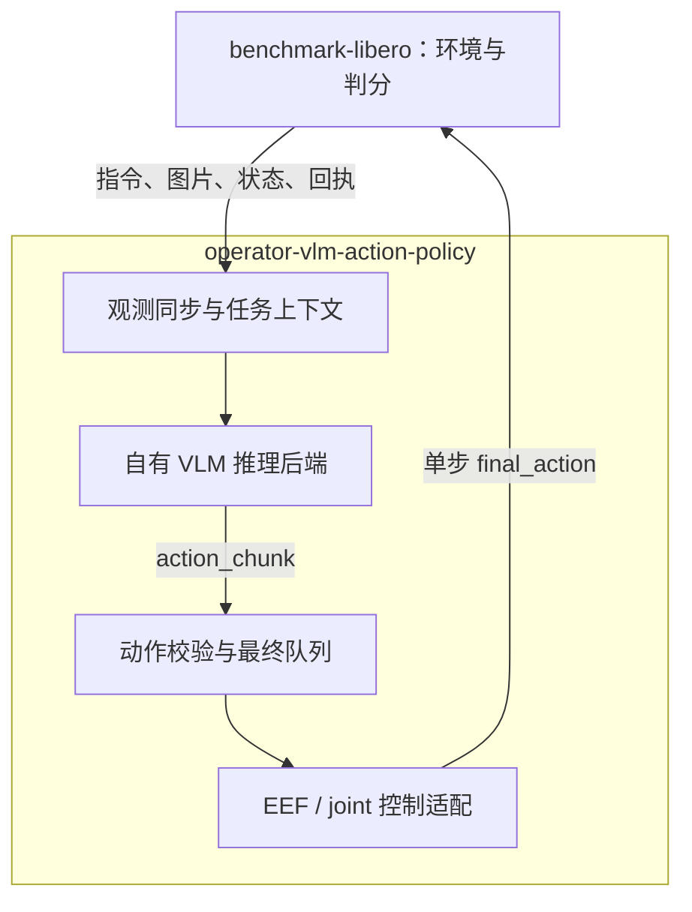
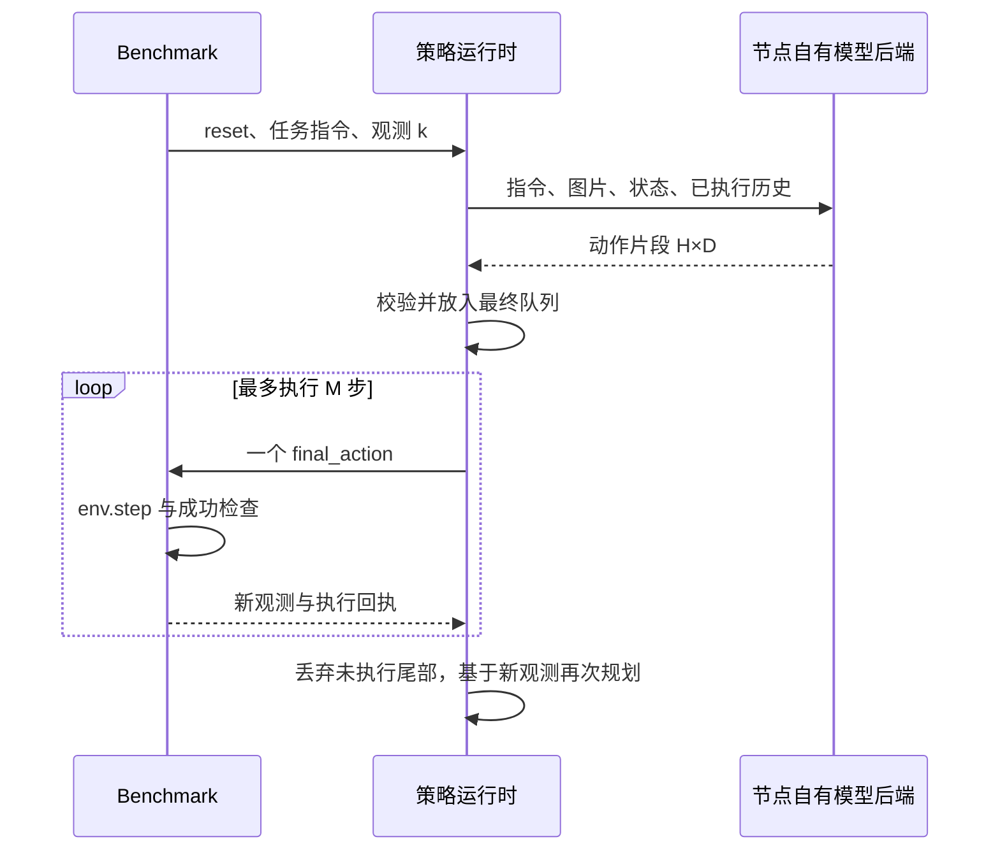
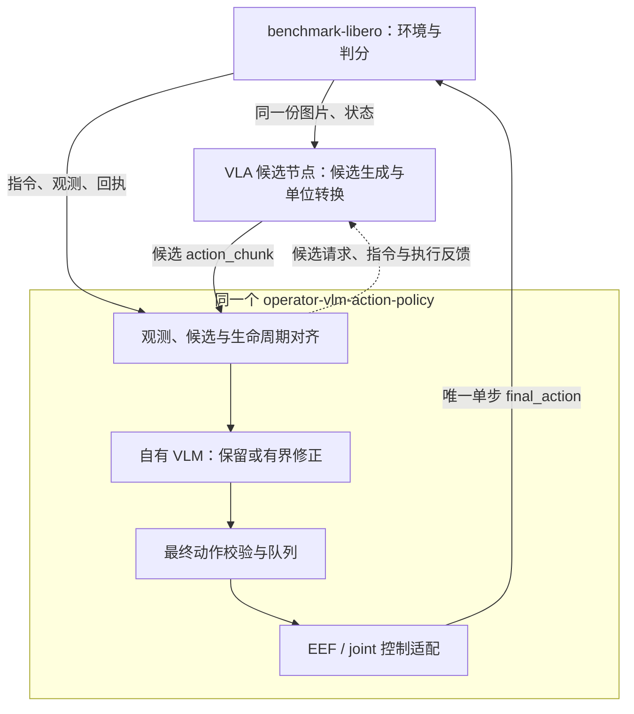
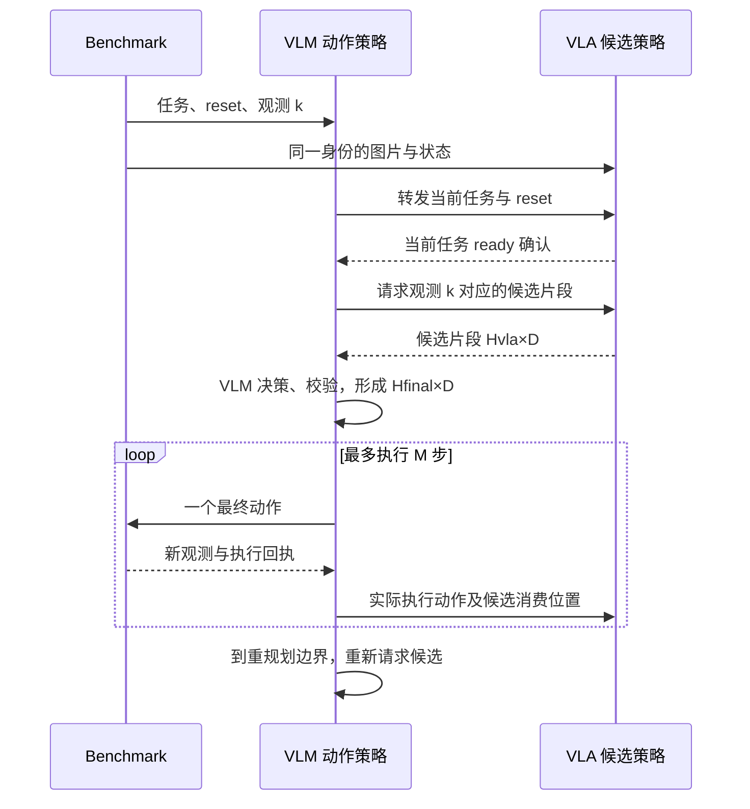

[English](DESIGN.md) | 简体中文

# VLM 动作策略设计

目标：用同一个 `operator-vlm-action-policy` 节点，支持 **VLM 独立控制**和 **VLA + VLM 组合控制**，最终封装成 benchmark Skill。

节点自行接入模型 API 或加载本地模型，不依赖已有 `operator-vlm-policy` 服务。**本文仅为设计，尚未实现。**

## 方案 A：VLM 独立控制

VLM 根据任务、图片和机器人状态生成一段动作，再逐步发送给环境。

### 架构图

这是两个业务节点。图中观测管理、模型后端、动作队列和控制适配器都是 **VLM 动作节点内部模块**，不单独部署为节点。模型后端可以直连模型 API，也可以在进程内加载本地模型。

| 节点 | 输入 | 输出 | 职责 |
|---|---|---|---|
| Benchmark | 单步动作 | 任务指令、图片、机器人状态、执行反馈、评测结果 | 运行仿真、推进环境、判定成功 |
| VLM 动作策略 | 任务指令、图片、机器人状态、执行回执与 reset 等命令 | 动作片段、逐步输出的最终动作、策略状态或错误 | 同步观测、维护任务上下文、调用模型、检查动作、管理队列并转换为环境动作 |

### 数据流图（运行时序）

H 为生成步数，D 为每步动作维数，M 为本轮最多执行的控制步数。

**例子：** 模型生成 4 步，先执行 2 步。每一步都等待环境返回新观测；两步后重新推理，原来的第 3、4 步不再继续回放。时序图中的策略运行时和模型后端属于同一个策略节点。

`tick` 只负责调度，不会凭空增加动作步。模型可以按片段调用；等待推理时仿真锁步暂停，因此推理实际耗时与环境控制周期要分别记录。

### 关键配置

| 关键配置 | 含义 | 示例 |
|---|---|---|
| `mode` | 独立控制 | `standalone` |
| `model.backend` | 节点直接使用的模型后端 | 模型 API 或进程内本地模型 |
| `action.space` / `dimension` | 动作类型和每步维数 | EEF 增量 / 7 |
| `action.prediction_horizon` | 一次生成多少步 | 4 |
| `action.execute_horizon` | 重新规划前最多执行多少步 | 2 |
| `action.frame` / `action.control_dt_s` | 动作参考系和单步控制周期 | world / 0.05 秒 |
| `runtime.inference_deadline_ms` | 一次模型推理的等待上限 | 60000 毫秒，示例预算 |

完整草案：[策略配置](../examples/libero/policy.yaml) · [dataflow.yaml](../examples/libero/dataflow.yaml) · [benchmark 配置](../examples/libero/benchmark.yaml)。

## 方案 B：VLA 提候选，VLM 做最终决策

VLA 先给出候选动作，VLM 结合相同的任务和观测，决定保留或修正。复用方案 A 的 VLM 动作节点。

### 架构图

这是三个业务节点。VLA 负责提出候选，VLM 动作节点拥有最终决策和执行队列。VLA 的候选不会绕过 VLM 节点直接发给环境。

| 节点 | 输入 | 输出 | 职责 |
|---|---|---|---|
| Benchmark | VLM 节点输出的单步动作 | 任务、图片、状态、执行反馈、评测结果 | 运行仿真并判分 |
| VLA 候选策略 | 任务、图片、状态、候选请求、实际执行反馈 | 候选动作片段、当前任务就绪状态 | 按请求生成候选，转换为约定的动作语义，依据实际执行反馈维护历史，不直接控制环境 |
| VLM 动作策略 | VLA 候选片段、任务、图片、状态、就绪确认和执行回执 | 最终动作片段、单步动作、候选请求、执行反馈与决策记录 | 对齐输入、保留或修正候选、校验最终动作、统一管理执行，转发任务生命周期 |

### 数据流图（运行时序）

**例子：** VLA 提供 8 步候选，VLM 形成 4 步最终片段，只执行其中 2 步后再规划。输入候选长度、最终片段长度和执行长度是三个独立参数。

VLA 必须收到实际最终动作的反馈，不能假定自己的候选已经全部执行。候选和当前图片、状态还必须对齐到同一任务与控制步，避免用旧候选处理新场景。

首版建议只允许**保留候选或有界修正**，夹爪默认沿用 VLA 命令。先使用串行的“VLA 候选→VLM 决策→执行”基线，异步预取和完整重规划以后单独评测。

### 关键配置

| 关键配置 | 含义 | 示例 |
|---|---|---|
| `mode` | 使用 VLA 候选 | `vla_conditioned` |
| `candidate.expected_horizon` | VLA 一次提供多少步 | 8 |
| `action.prediction_horizon` | VLM 最终形成多少步 | 4 |
| `action.execute_horizon` | 重新规划前最多执行多少步 | 2 |
| `candidate.dimension` / `action.dimension` | 输入与最终动作维数 | 首版都为 7，且语义一致 |
| `refinement.strategy` | VLM 如何处理候选 | `bounded_residual`，有界修正 |
| `refinement.allow_gripper_override` | 是否允许改夹爪命令 | 默认 false |
| `candidate.deadline_ms` / `candidate.on_timeout` | 等待候选的期限和失败处理 | 3000 毫秒 / 中断评测 |

候选片段、候选请求和执行反馈需要扩展现有 VLA runner。VLA 不能自行消费队列或同时向环境发动作；观测与候选必须通过同一 episode/step 身份对齐。

完整草案：[最终策略配置](../examples/vla_vlm/policy.yaml) · [VLA 配置](../examples/vla_vlm/vla.yaml) · [dataflow.yaml](../examples/vla_vlm/dataflow.yaml) · [benchmark 配置](../examples/vla_vlm/benchmark.yaml)。

## 两种方案共用的规则

- **环境只接收单步动作。** action_chunk 留在策略内部管理，按新观测逐步消费。
- **步数和维数可配置，但动作语义必须明确。** EEF 增量通常为 7 维，位置加四元数及夹爪为 8 维，N 个关节加夹爪通常为 N+1 维；改变维数不能自动转换动作类型。
- **默认 LIBERO 使用 EEF 控制。** joint 输出需要真实关节状态和匹配的关节控制器；[关节配置草案](../examples/joint/policy.yaml)单独提供。
- **reset 清理整条策略链。** 清空动作队列与上下文，丢弃旧任务的迟到结果；历史只记录已确认执行的动作。
- **失败要明确记账。** 超时或非法动作默认中断评测；不静默回退。成功与否由 benchmark 判定。

主视角/腕部图片由 `image/*` 传入，状态由 `proprio_state` 传入，任务与 reset 等命令由 `policy_command` 传入；逻辑上的最终动作使用 `action` 端口。完整连线以各方案的 dataflow 草案为准。

图中的回执表示对应环境步已完成，身份关联协议仍需在正式集成时补充；不能仅凭任意一张新图片认定动作已完成。

控制周期、单位、坐标系、夹爪方向、动作限位和超时也要固定在配置中。模型去归一化与环境控制器缩放须分别处理。详细约定见[接口说明](CONTRACTS_zh.md)，主文档不展开协议字段。
