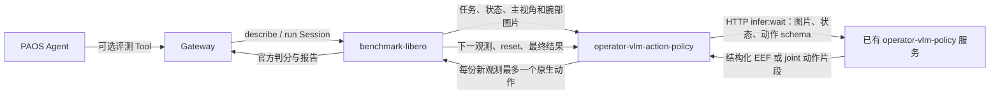
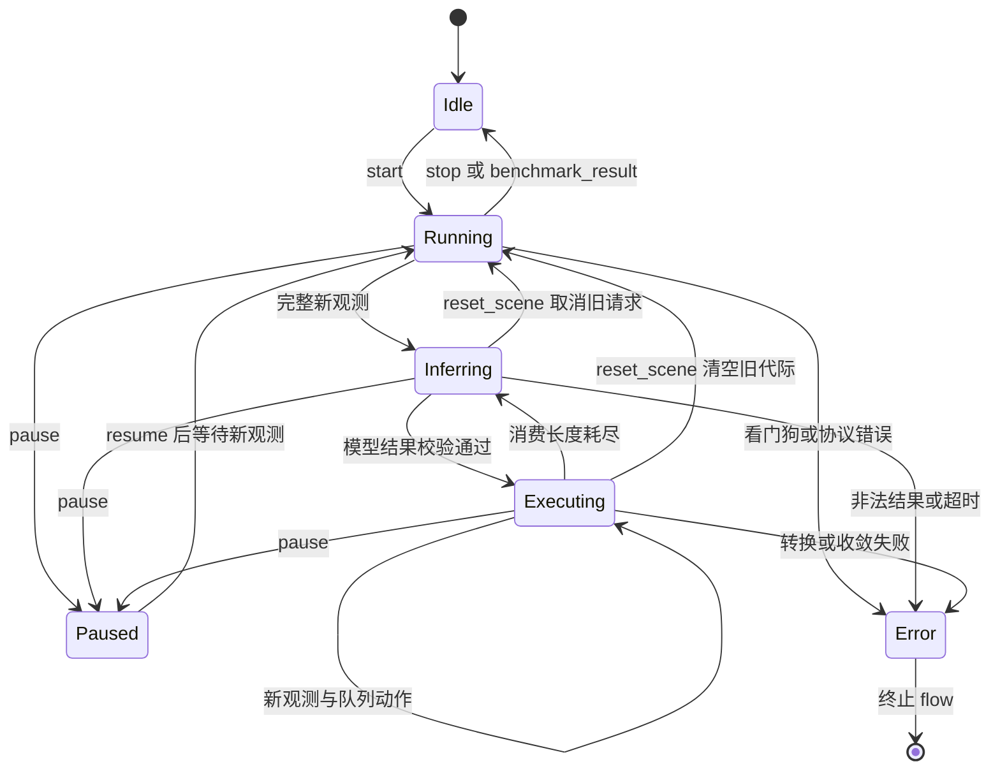

[English](DESIGN.md) | 简体中文

# VLM 动作策略与 benchmark Skill 完整方案

## 1. 定位与实现边界

`operator-vlm-action-policy` 是内部常驻计算节点。它接收观测及生命周期命令，调用已有 `operator-vlm-policy`，校验模型输出，管理动作片段，每份新观测最多输出一个原生动作。Agent 不参与逐步控制循环。本项目不训练动作头，也不预先承诺通用 VLM 的控制精度。

已实现：异步通用服务客户端；EEF 增量、EEF 位姿、关节位置输出；有界位姿伺服；单步动作额度；chunk 消费；执行反馈历史；生命周期控制；reset 代际隔离；超时看门狗；公共 Forge Arrow 消息字段；旧版 LIBERO 与严格 observation-v1 输入驱动。测试使用受控模型响应和传输夹具。

尚未证实：真实模型的 LIBERO 成功率、真实 LIBERO 仿真验收、实机安全、全机器人碰撞检查、IK、Forge 2/Dora 1 部署。关节输出要求匹配的关节控制器和真实关节观测。上游 LIBERO 默认配置仅接收末端动作。

## 2. 整体流程图与节点数量



- 自动运行：两个 Dora 节点（benchmark、动作策略），加一个独立管理的通用 VLM HTTP 服务；其后端模型可本地或远程。
- PAOS Tool 控制的 Skill：增加 Gateway，总计三个 Dora 节点，仍复用同一 HTTP 服务。
- 本仓库拥有一个生产策略节点；启动脚本和打包辅助程序不计为额外推理节点。
- 策略节点新增 Endpoint、Tool 和 HTTP 监听均为零。可选 Gateway 绑定 benchmark 已有 `benchmark.controller`：`describe` Query 和 `run` Session。建议 Tool ID 为 `vlm_libero.benchmark.describe`、`vlm_libero.benchmark.run`。
- Session 接受不代表评测完成；批次执行完成也不代表任务全部成功。

## 3. 每个节点的输入输出

| 组件 | 输入 | 输出 | 职责 |
|---|---|---|---|
| benchmark-libero | 原生七维 `action` JointCommand；可选 `tool_in` | `proprio_state`、`image/main`、`image/second`、`policy_command`、`benchmark_status`、`benchmark_result`；可选 `tool_out` | 独占环境 reset/step、任务计划、官方判分、录像与报告 |
| 动作策略节点 | `tick`、`policy_command`、`proprio_state`、配置的 `image/*`、`benchmark_result`；或 `observation` 整体快照 | `action` JointCommand + 身份元数据；`action_chunk`、`policy_state`、`policy_error` JSON | 推理调度、动作契约、队列消费、旧结果作废 |
| 通用 VLM 服务 | `/v1/infer:wait`：messages、图片、context、response_format、limits | `vlm.infer.result.v1`，包含 `execution_status`、`output.json`、provenance、usage | 模型路由、凭据、图片导入、通用推理和上下文存储 |
| 可选 Gateway | Agent Tool 请求、benchmark Tool 响应 | benchmark Tool 请求、Agent 响应 | Query/Session 路由和调用生命周期 |

`action`、`action_chunk`、`policy_state` 都是数据流输出，不是 Tool operation。模型名称和 effort 继续由已有通用服务配置；可通过 `model_route` 选择已有路由，本仓库不静默替换模型或 effort。

## 4. 输入观测与同步

建议的应用层 `Observation` 包含：

- `episode_id`、`epoch`、`step_id`、`obs_id`：显式关联身份。
- `state`：有限数值列表，由 `state_names`、`state_semantics` 解释。
- `images`：相机别名到 `{mime_type, data}` 的映射，data 为图片 base64。
- 指令由 `PolicyCommand(set_instruction)` 下发，`reset_scene` 建立新 episode。

已实现两种输入驱动：

1. `legacy_libero`：兼容上游分开发送的 Image/JointState。每个相机和状态都收到一份新消息后组装完整观测；下一动作必须等待下一份完整观测；reset 使用 Dora 传输时间戳水位线，丢弃旧观测并保留其他端口提前送达的新观测。身份由策略本地生成。它依赖单生产者、单动作写入者、各端口有序，以及 reset 后没有旧的跨端口消息。这不能证明图片与状态原子同步，也无法完全排除跨 episode 的迟到帧；`policy_state` 明确标识该同步模式。
2. `observation_v1`：通过一个 Arrow string 发送完整观测 JSON。`reset_scene.inputs` 必须携带 `episode_id` 和整数 `epoch`，拒绝旧身份和跳步。生产者还需校验动作关联身份。当前上游 benchmark 尚未提供这个端口，使用它需要扩展 benchmark；默认 dataflow 不启用此模式。

现有 LIBERO 八维状态实际为 **EEF 位置三维 + 旋转向量三维 + 双指位置二维**。`joint1..joint7, gripper` 是历史消息标签，不能解释为七个机械臂关节角。joint profile 必须提供指定顺序的真实关节位置。

支持原始 RGB8/BGR8 Forge Image，包括行填充；编码为 PNG 后通过通用服务已有 `inline_base64` 输入，不依赖共享文件系统。Prompt 不注入物体真值、仿真状态向量、判分谓词或特权物体位姿。benchmark 已处理的图像不再重复翻转。

## 5. 动作输出与执行语义

模型输出 `action_space`、`frame`、`actions`。运行时绑定真实请求观测，发布 `vlm.action_chunk.v1`，补充 episode 身份、来源观测/步号、chunk ID、`dt_s`、消费长度和模型来源记录。

| 类型 | 每行动作维度 | 含义 | 原生输出 |
|---|---|---|---|
| `eef_delta` | 七维 | 世界系平移增量（米）、世界系旋转增量向量（弧度）、归一化夹爪 | LIBERO OSC 七维归一化控制量 |
| `eef_pose` | 八维 | 世界系位置（米）、单位四元数 **xyzw**、归一化夹爪 | 每次使用最新 EEF 观测重新计算有界 OSC 增量 |
| `joint_position` | N+1 维 | N 个绝对关节角（弧度）、归一化夹爪 | 指定名称顺序的 N+1 位置控制量 |

当前 EEF 适配器要求 `frame: world`。词汇中预留 `robot_base`，但当前适配器会拒绝该配置，不猜测坐标转换。模型结果经过维度、有限值、动作类型、坐标系、夹爪及物理范围检查。使用 `JointCommand` 作为载体不会把 EEF 动作变成关节角。

EEF 增量按平移/旋转向量范数限幅，原生归一化使用显式配置的比例；例子为 0.05 米、0.5 弧度。真实评测前核对已安装 OSC 的比例、坐标系和夹爪方向。工作空间检查仅约束目标及下一步 EEF 指令，不提供整条运动扫掠体的碰撞保证。

EEF 位姿目标会保留至最新观测达到位置和姿态容差，并受 `max_servo_steps` 限制。姿态误差采用最短四元数误差 `log(R_target R_current^-1)`；即使已经到位，也会发送夹爪命令。位姿目标可能跨多个环境步，`dt_s` 表示单步仿真时间，不表示一个周期内即可到达绝对目标。

joint 输出检查关节上下限及相对当前关节的最大变化。下游必须匹配“绝对关节位置 + 归一化夹爪”协议；不会自动将关节角转成 LIBERO OSC。上游 LIBERO 当前仅消费前七维，因此 Panda 七关节加夹爪路线需要更换控制器及 benchmark 动作适配。未来 EEF→IK→joint 必须显式加入运动学、求解失败和残差契约，本次没有实现 IK。

## 6. 常驻状态、时序与上下文



`tick` 推进异步推理和调度，不产生额外环境步额度。每份完整新观测最多消费一个动作。模型等待期间，benchmark 锁步暂停仿真；实际耗时和仿真时间分别统计。

模型生成 H 行，只排入前 M=`execute_horizon` 行。EEF 增量和 joint 每行消费一次额度；EEF 位姿每个目标可能消费多个额度直到收敛。未消费尾部会丢弃，reset 或重新规划后不继续回放。

支持 `start`、`pause`、`resume`、`stop`、`reset`、`reset_scene`、`set_instruction`。policy_id 必须匹配，`*` 为显式广播。指令替换、reset、暂停和停止会取消本地推理、尝试远端取消、清空观测和动作队列及历史，旧推理结果无法重新填充队列。`reset_scene` 保持运行状态；`reset` 返回 idle。正常 episode 和批次之间进程保持常驻，最终报告使策略回到 idle。

下一轮模型只收到有后续观测回执的有限执行历史，不包含尚未执行的模型尾部。legacy 中后续观测仅是回执代理，严格确认需要 observation-v1 生产者配合。通用推理请求使用 stateless，episode 历史由动作运行时显式维护并在边界清理，不跨评测集隐式复用模型会话。

非法输出、协议错误、看门狗超时或目标不收敛会输出 `policy_error` 并终止 flow，不生成替代移动。当前上游 benchmark 没有 policy-error/abort 输入，Session stop 在 episode 边界生效；外部运行管理应将中断归为策略/基础设施失败，保留计划中未完成的 episode，不能当成正常完成或从统计中静默剔除。未来结构化 abort 输入属于 benchmark 集成扩展。

## 7. dataflow.yaml 与部署

完整两节点例子见 [dataflow.yaml](../examples/libero/dataflow.yaml)，配套 [benchmark.yaml](../examples/libero/benchmark.yaml)、[policy.yaml](../examples/libero/policy.yaml)。替换 `/opt/...` 路径，在 benchmark 环境安装 LIBERO/robosuite，并独立启动已有通用 VLM 服务：

```yaml
# Replace executable paths and benchmark checkout path. Run from this directory.
# LIBERO main e1eb5b6 uses Dora 0.4.1. Both processes AND the Dora CLI must match.
# Start the existing operator-vlm-policy HTTP service separately before this flow.
nodes:
  - id: libero_benchmark
    path: ./benchmark.sh
    env:
      BENCHMARK_CONFIG: ./benchmark.yaml
      LIBERO_PYTHON: /opt/libero-env/bin/python
      LIBERO_NODE_ROOT: /opt/benchmark-libero
      MUJOCO_GL: egl
      PYOPENGL_PLATFORM: egl
    inputs:
      action:
        source: vlm_policy/action
        queue_size: 1
    outputs: [proprio_state, image/main, image/second, policy_command, benchmark_status, benchmark_result]

  - id: vlm_policy
    path: ./policy.sh
    env:
      VLM_ACTION_PYTHON: /opt/vlm-action-env/bin/python
      VLM_ACTION_CONFIG: ./policy.yaml
    inputs:
      tick: dora/timer/millis/20
      policy_command:
        source: libero_benchmark/policy_command
        queue_size: 32
      proprio_state:
        source: libero_benchmark/proprio_state
        queue_size: 1
      image/main:
        source: libero_benchmark/image/main
        queue_size: 1
      image/second:
        source: libero_benchmark/image/second
        queue_size: 1
      benchmark_result: libero_benchmark/benchmark_result
    outputs: [action, action_chunk, policy_state, policy_error]
```

```bash
uv sync --frozen --all-extras --group dev
uv run operator-vlm-action-policy validate --config examples/libero/policy.yaml
uv run operator-vlm-action-policy schema --config examples/libero/policy.yaml
cd examples/libero
dora run dataflow.yaml
```

节点入口为 `operator-vlm-action-policy run --config policy.yaml`。模型由通用服务加载与选择；动作节点没有模型管理 Tool。HTTP 服务、策略版本、LIBERO/robosuite/控制器参数及 Dora CLI/runtime 一起锁定。

例子依据上游 benchmark-libero `e1eb5b6c398c04065911336075efe30091d9570c`：Dora 0.4.1 与公共 Forge 消息字段。动作节点原生实现窄范围 Arrow 字段，避免引入整个 forge-msgs 依赖，PNG 编码使用已修补 Pillow 13，没有复制 SDK 源码。Forge 2/Dora 1 迁移需要另行验证，当前 lock 不声明该兼容性。

## 8. PAOS Skill 封装

[examples/skill](../examples/skill) 提供源码模板：manifest、SKILL 操作指引、启动脚本、三节点 Tool dataflow 和 Gateway 绑定。格式参考已有 PAOS 示例；它不是已安装并验收的 Skill 制品，发布前需要在选定 PAOS 运行时验证 manifest 展开、Gateway 版本和 Session 互通。

Skill 负责：

1. 解析锁定的策略、benchmark、Gateway 制品和环境，检查通用 VLM 服务就绪。
2. 启动一个常驻 dataflow，调用 describe 获取真实任务和初始状态范围。
3. 按固定评测计划开启 run Session，查询状态，逐步动作由节点内部执行。
4. 获取终态、官方成功率、动作和模型来源记录、可选视频。
5. 用户停止请求在 episode 边界处理，硬中断/超时单独归类。

Prompt、动作 schema、控制参数、环境映射随 Skill 配置。凭据留在部署环境和通用服务配置，不打包模型密钥、provider 文件、benchmark 数据集或模型权重。

## 9. 测评与验收

验收分三层：

- 协议/运行时：真实通用服务响应互通、一观测一动作、reset 取消、单位与比例、位姿伺服、关节限制。
- 仿真集成：真实 Dora + LIBERO、动作维度、相机方向、官方成功判断、reset/批次完成、报告/录像和中断记账。
- 模型能力：固定任务与初始状态、多次运行、实际配置的模型/effort、冻结 prompt/动作适配器，统计真实成功率与消耗。

记录逐任务/总体成功率、终止原因、计划/完成集数、环境步数、仿真时间、实际耗时、模型调用数及延迟 p50/p95、token usage；费用仅在有价格依据时计算。保留非法结果、超时及基础设施错误。RGB-only、深度辅助、grounding 辅助分别作为 profile；更改关节控制器或动作空间也应单独披露。VLM 自报完成不参与官方成功判定。

## 10. 参考源码

- [benchmark-libero](https://github.com/PhyAgentOS/benchmark-libero)：`_core/runner.py`、`adapters/libero_adapter.py`、`dataflow.example.yaml`、`bench_tool/descriptor.py`。
- [LIBERO 环境封装](https://github.com/Lifelong-Robot-Learning/LIBERO/blob/master/libero/libero/envs/env_wrapper.py)。
- [robosuite 1.4.1 OSC 配置](https://github.com/ARISE-Initiative/robosuite/blob/v1.4.1/robosuite/controllers/config/osc_pose.json)。
- [Forge 公共消息字段](https://github.com/PhyAgentOS/forge/tree/master/packages/msgs/src/forge_msgs)。
- [operator-vlm-policy](https://github.com/PhyAgentOS/operator-vlm-policy)。
